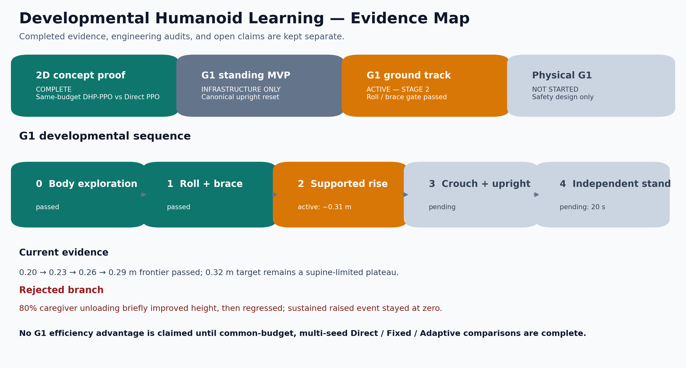
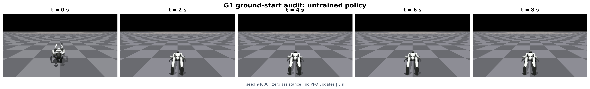
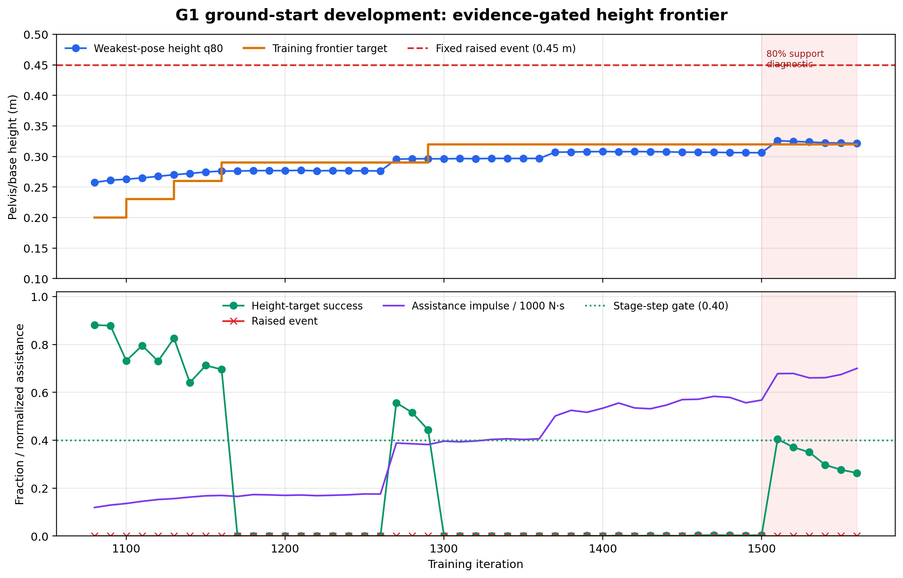
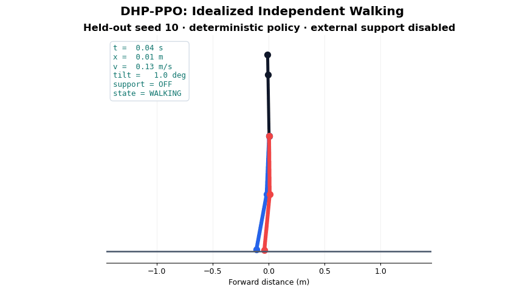
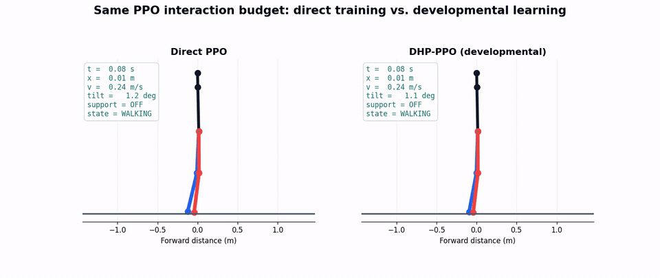
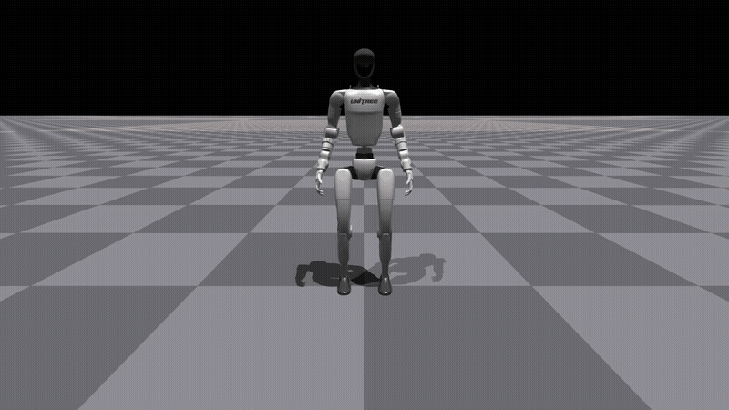
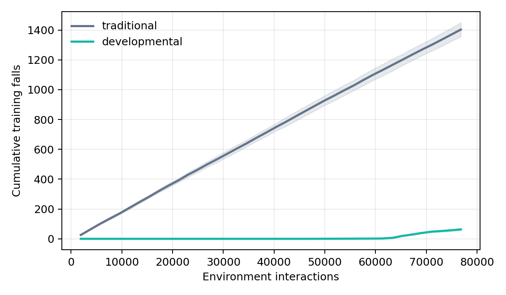
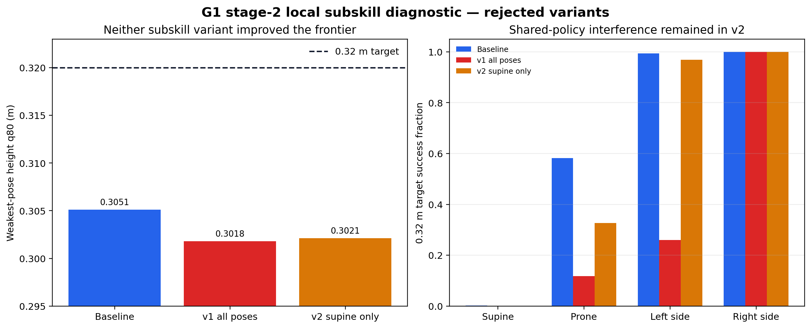

# Developmental Humanoid Learning

> Human-inspired developmental motor learning for safer and more sample-efficient humanoid locomotion.

[](https://www.python.org/)
[](https://pytorch.org/)
[](#当前证据地图)
[](#快速开始)

本项目研究一个区别于“海量仿真摔倒 → 单任务策略”的人形机器人运动学习方向：机器人从地面开始，在安全约束和可撤除搀扶下，通过身体探索形成 **Body Schema**，再逐步学习翻身、支撑、起身、站立和行走。

仓库包含两条必须分开理解的证据轨：二维火柴人概念验证已经完成同预算对照；Unitree G1 地面发育轨正在学习，目前只通过了翻身/支撑能力门，尚未学会稳定起身。旧的近站立 G1 checkpoint 只保留为控制和评估基础设施审计，不再充当“类婴儿学习”成果。

后续研究以少量真实交互中的身体认知、协调能力与技能积累为目标，优先验证 **自监督在线身体建模 + 局部预测控制 + 能力门控**。PPO 作为对照算法保留。目前新增 NumPy 固定模型与门控的 CPU 原型，尚未验证这条新路线的在线学习收益；既有 G1 历史证据与本轮 CPU 验证分开报告。当前仅 CPU、暂不训练，阶段任务与验收见 [项目推进路线](docs/DEVELOPMENT_ROADMAP.md)。

> [!IMPORTANT]
> 当前方法优势只由透明的二维理想动力学实验支持，不是 G1 或真机结论。G1 数值均为单 seed 方法开发证据。项目公开平台期、退化分支、后验阈值修正、辅助预算和失败 checkpoint，不把训练过程包装成最终成功。

## 当前证据地图



| 证据层级 | 当前状态 | 已证明 | 尚未证明 |
|---|---|---|---|
| 二维火柴人概念验证 | **完成** | 同为 76,800 interactions 时，完整 DHP-PPO 比 Direct PPO 少 95.51% 严重跌倒，并完成无支撑行走 | 单个组件的因果贡献、刚体接触泛化 |
| CPU 无训练机制诊断 | **失效 144 组、历史/时域 120 组完成** | 发现延迟失效与不利退级；H50 下已知延迟的历史预测有条件改善控制 | 身体模型学习、历史/时域的普适优势、G1/真机能力 |
| G1 近站立工程轨 | **降级为基础设施审计** | 模型加载、并行训练、evaluation-only、长时域运动验收可运行 | 从地面学习、方法优于 PPO |
| G1 地面发育轨 | **阶段 2 进行中** | 四种躺姿起点；翻身/支撑门通过；高度前沿推进至 0.29 m | 持续起身、独立站立、Direct/Fixed/Adaptive 优势 |
| G1 真机 | **未开始** | 仅有安全边界和系统设计 | Sim2Real、真实机器人自主学习 |

```text
地面身体探索 ──通过──> 翻身 / 多点支撑 ──通过──> 辅助起身 ──平台──> 蹲姿 / 直立 ──未到达──> 零辅助站立
   stage 0                 stage 1                 stage 2                 stage 3               stage 4
                                                当前最弱高度≈0.31 m                           20 s 验收
```

我们不把“还没摔倒”“某一帧抬得很高”或“搀扶下达到目标”记为能力获得。所有晋级均使用独立计账的 held-out episode bank、四种初态中的最弱结果、安全余量和连续多窗口确认。

## 最新 G1 地面发育进展



上图是随机策略、0 PPO update、0 assistance 的地面起点审计，只证明任务真正允许仰卧/俯卧/侧卧和地面接触；它不是学习成果。



阶段 1 已在四种躺姿上连续通过翻身/支撑门。阶段 2 的训练目标由 held-out 证据按 `0.20→0.23→0.26→0.29 m` 推进；随后在 0.32 m 前沿形成平台。红色区域是把部分卸载从 65% 提高到 80% 的诊断：最弱高度短暂到 0.326 m，但成功率继续训练后退化至 26.3%，持续 raised 仍为 0，因此该分支被否决并恢复 65% 默认。

- [8 秒未训练地面起点 MP4](results/validation/media/g1_ground_start_untrained.mp4)
- [轻量 GIF 预览](results/validation/media/g1_ground_start_untrained_preview.gif)
- [49 个 held-out 窗口的冻结绘图数据](results/validation/g1_ground_frontier_progress_20260826.json)
- [局部能力链失败诊断数据](results/validation/g1_supine_subskill_diagnostic_20260826.json)
- [逐次实验、失败和修复日志](docs/EXPERIMENT_LOG.md)
- [G1 方法与能力门定义](docs/DEVELOPMENTAL_G1_METHOD.md)

## 已完成的二维概念验证

### 发育式策略：无支撑行走



### 相同 PPO 环境交互预算：同步对比



左侧直接 PPO 在约 2.36 s 后跌倒并停留在失败状态；右侧 DHP-PPO 在关闭外部支撑后继续完成 12 s 测试回合。

- [完整无支撑行走视频（Supplementary Video S1）](results/validation/media/developmental_walk.mp4)
- [直接 PPO 与发育式策略同步对比（Supplementary Video S2）](results/validation/media/ppo_vs_developmental.mp4)
- [中文论文初稿](paper/论文初稿.md)

## G1 近站立工程审计（非核心成果）



冻结 model 4260 在五个新 seed 的 40,960 条 20 秒轻初速度扰动轨迹中全部站满并通过恢复站立验收；100 秒测试为 8,191/8,192（99.9878%），因为一条轨迹超过冻结的 3 秒紧姿态恢复窗。但该任务从 0.8 m 标准直立姿态开始，低高度/倾斜立即终止，按定义无法学习地面探索和起身。因此它只证明控制、录像和长时域 evaluation-only 基础设施可用，不能支持项目核心命题。

- [冻结测试四面板总览](results/validation/g1_frozen_standing_summary.png)
- [零注入站立 MP4](results/validation/media/g1_motion_aware_standing.mp4)
- [轻初速度扰动恢复 MP4](results/validation/media/g1_mild_disturbance_recovery.mp4)
- [论文完善与多媒体证据计划](docs/PAPER_COMPLETION_PLAN.md)

## 为什么做这个项目

现有运动学习系统能够借助 PPO、人体动作模仿和大规模并行仿真实现高动态动作，但将大量失败搬到真实机器人上会带来摔倒、冲击、磨损、能耗和人工复位成本。

人类学习行走并不是从随机动作直接跳到连续步态，而是经历低风险探索、多接触支撑、平衡、站立、重心转移和辅助行走。这个项目希望验证：

> 机器人能否少摔、少试、少依赖大规模仿真，同时通过身体知识和技能积累逐渐学会复杂运动？

## 项目优势

| 维度 | 直接任务强化学习 | 本项目的发育式路线 |
|---|---|---|
| 学习起点 | 随机策略或单任务初始化 | 纯发育轨从随机策略开始；人体先验轨单独披露 |
| 技能组织 | 直接学习最终任务 | 地面探索 → 翻身/支撑 → 起身 → 站立 → 行走 |
| 风险管理 | 跌倒后惩罚并复位 | 从强支撑逐步解除支撑，并惩罚失稳前状态 |
| 知识使用 | 新任务经常重新训练 | 同一条件策略持续迁移先前能力 |
| 优化目标 | 容易只关注 Reward | 同时报告成功、跌倒、交互、距离和动作误差 |
| 可解释性 | 端到端策略较难拆解 | 人体先验、Body Schema 和课程均可单独消融 |

更完整的技术定位、优势边界与研究假设见 [项目优势与技术路线](docs/PROJECT_OVERVIEW.md)。

## 二维概念验证结果

未参与调参的训练种子为 10–14。每个方法、每个种子使用 76,800 次环境交互，最终统一关闭外部支撑并测试 30 回合。

| 指标 | 直接 PPO | DHP-PPO |
|---|---:|---:|
| 无支撑成功率 | 0.000 ± 0.000 | **1.000 ± 0.000** |
| 测试跌倒率 | 1.000 ± 0.000 | **0.000 ± 0.000** |
| 训练期严重跌倒 | 1402.8 ± 47.5 | **63.0 ± 7.0** |
| 平均前进距离 | 1.899 ± 0.318 m | **9.400 ± 0.266 m** |
| 关节跟踪 RMSE | **0.273 ± 0.027** | 0.316 ± 0.003 |
| 环境交互 / seed | 76,800 | 76,800 |
| 额外人体先验样本 / seed | 0 | 8,192 |

训练期严重跌倒减少 **95.51%**。与此同时，DHP-PPO 的关节 RMSE 略差；这说明短时动作相似性不等于长期闭环稳定，也说明不能只展示有利指标。



逐种子数据见 [`metrics_by_seed.csv`](results/validation/metrics_by_seed.csv)，统计量见 [`statistics.json`](results/validation/statistics.json)。

## 二维 DHP-PPO 方法概览

```text
Synthetic Human Motor Prior
              │
              ▼
       Conditioned Policy ◄──── Body Schema / Forward Prediction
              │
              ▼
Body Babbling → Balance → Weight Transfer → Supported Walk → Independent Walk
      100% support                                         0% support
```

DHP-PPO 包含三个核心组件：

1. **可审计的人体运动先验**：使用左右交替步态相位和类似前庭反馈的髋部平衡修正，不把先验隐藏在不可追踪的数据处理中；
2. **Body Schema 辅助目标**：策略表征同时预测下一时刻关节、躯干与速度状态；
3. **条件化发育课程**：同一策略从低风险身体探索逐步过渡到完全无支撑行走，阶段切换不重置参数。

二维结果验证的是完整组合方案，不应被解释为其中任何单个组件已经获得因果证明。G1 纯发育轨不使用该二维人体步态教师；将来使用动作数据的 G1 人体先验轨会作为额外信息预算单独报告。

## 我们已经走过的路线

| 阶段 | 尝试与发现 | 决策 |
|---|---|---|
| 二维概念验证 | Direct PPO 在同预算下反复跌倒；组合方法完成无支撑行走 | 保留为第一阶段可复现证据，但不外推到 G1 |
| G1 Standing MVP | 从 0.8 m 标准直立 reset 学会有限时域站立 | 发现任务定义排除了婴儿式地面学习，降级为基础设施审计 |
| 评估修复 | 发现评估入口曾额外更新模型，旧“严格 100%”还掩盖瞬时回摆 | 建立 evaluation-only、hash/steps 不变检查、运动占空与连续越界验收 |
| 地面任务重启 | 四种 0.12 m 躺姿、地面接触不终止、无预训练任务策略 | 成为 G1 核心研究轨，旧站立 checkpoint 不迁移为成果 |
| 身体探索 | 修复 Body Schema 绝对误差虚高、episode 重复计票和 reset 广播 | 使用相对 persistence 增益与每 episode 一票 |
| 翻身/支撑 | 解决动作权限不足、初态不可观测、困难姿态遗忘和力矩反馈缺失 | iteration 1000 连续通过阶段门，约 196.8M RL steps |
| 辅助起身 | 远端 0.50 m 目标无梯度；改为 3 cm held-out 能力小台阶 | 推进到 0.29 m；0.32 m 平台仍未解决 |
| 搀扶消融 | 65% 部分卸载平台；80% 短暂改善后退化 | 拒绝 80% 分支，默认恢复 65%，下一步针对仰卧技能链 |

这张表不是“成功故事”的删节版。完整的每次失败、配置变动、训练预算和科研边界均保存在 [实验日志](docs/EXPERIMENT_LOG.md)，后验修改不会被描述成预注册设计。

### 本轮升级诊断：局部能力链被否决

我们尝试把 `转体 × 多点支撑 × 屈膝收腿` 作为 stage-2 非补偿式准备分数。v1 对全部姿态启用，v2 只对 supine 启用；两者均从同一 model 1500 训练约 3.93M RL steps，再用 seed 95001、8,192 env × 400 steps 做 evaluation-only 对照。



结果不是提升：baseline/v1/v2 的最弱高度分别为 0.3051/0.3018/0.3021 m，supine 的 0.32 m 成功率分别为 0.199%/0.050%/0%。v1 虽把 low-saturation 从 90.95% 提到 91.36%、辅助冲量降低约 12%，却严重破坏 prone 和 left-side；v2 仍存在共享策略干扰。因此默认配置已关闭该奖励，复现 overlay 和冻结 JSON 保留。下一候选方向是从策略自己到达的安全中间状态建立 episode bank，让机器人反复练习 0.30→0.32 m 的局部转换，而不是继续提高搀扶或奖励权重。

## 快速开始

### 环境

- Python 3.10+
- NumPy
- PyTorch 2.0+
- Matplotlib
- pandas / SciPy
- FFmpeg（仅重新导出 MP4 时需要）

### 安装与测试

```powershell
python -m pip install -e .
$env:PYTHONPATH = "src"
python -m pytest -q
```

### PBHC + G1 仿真接入

G1 阶段以 PBHC 的 HumanoidVerse、机器人资产和训练入口为上游底座，不在二维包中
重新实现仿真环境。完成外部依赖安装后，可运行一个环境、一个 PPO iteration 的
GPU smoke test：

```bash
bash scripts/pbhc_smoke.sh
```

固定版本、路径、许可证、已验证结果和科研边界见
[PBHC 接入与本机复现记录](docs/PBHC_INTEGRATION.md)。

自研 G1 发育式任务（无动作参考、含成熟动作约束与 Body Schema）的最小 GPU 验证：

```bash
bash scripts/pbhc_developmental_smoke.sh
```

方法边界、配置结构和当前尚未完成的实验见
[G1 发育式任务学习说明](docs/DEVELOPMENTAL_G1_METHOD.md)。

复现论文中的 G1 能力边界图：

```bash
python scripts/plot_ground_frontier_progress.py \
  results/validation/g1_ground_frontier_progress_20260826.json
```

### 复现实验

当前用户要求仅做 CPU 无训练验证，暂不运行下面的历史 PPO 训练命令。可先执行：

```powershell
$env:PYTHONPATH = "src"
python -m developmental_control.validate --output results/cpu_validation/final
```

该命令只执行固定模型闭环仿真与门控状态变化，模型和策略参数更新为零。原型范围、实测结果与后续 CPU 方法见 [CPU 无训练验证](docs/CPU_VALIDATION.md)。以下为历史二维成果的复现入口：

```powershell
$env:PYTHONPATH = "src"
python -m robot_rl.experiment `
  --seeds 10 11 12 13 14 `
  --updates 40 `
  --num-envs 24 `
  --rollout-steps 80 `
  --eval-episodes 30 `
  --output results/validation
```

### 导出论文视频

训练检查点默认不纳入 Git；重新训练后可执行：

```powershell
$env:PYTHONPATH = "src"
python -m robot_rl.video `
  --developmental results/validation/developmental_seed10.pt `
  --traditional results/validation/traditional_seed10.pt `
  --output results/validation/media

ffmpeg -i results/validation/media/ppo_vs_developmental.mp4 `
  -vf "fps=12,scale=960:-1:flags=lanczos" `
  results/validation/media/ppo_vs_developmental.gif
```

## 项目结构

```text
developmental-humanoid-learning/
├── src/robot_rl/
│   ├── env.py            # 二维火柴人动力学、课程与奖励
│   ├── ppo.py            # PPO、人体先验和 Body Schema
│   ├── evaluate.py       # 无支撑评估与轨迹记录
│   ├── experiment.py     # 多随机种子对照实验
│   └── video.py          # MP4 / GIF 导出
├── src/developmental_g1/ # PBHC G1 成熟控制、Body Schema 与算法扩展
├── src/developmental_control/ # NumPy 固定模型控制与能力门控 CPU 原型
├── configs/pbhc/         # 不修改上游源码的 Hydra overlay
├── tests/                # 环境和先验单元测试
├── results/validation/   # 未见种子结果、图表与视频
├── docs/                 # 项目定位与研究路线
├── paper/论文初稿.md      # 中文论文初稿
└── pyproject.toml
```

## 项目阶段

- [x] 理想二维火柴人环境
- [x] 直接 PPO 基线
- [x] 发育课程、人体运动先验与 Body Schema
- [x] 5 个未见种子的正式验证
- [x] 论文图表、检查点和补充视频
- [ ] 课程 / Body Schema / 人体先验的因子消融
- [x] 在可用 GPU 环境中锁定 PBHC、Isaac Gym Preview 4 和 Unitree G1 资产
- [x] 建立统一 G1 关节/刚体/action 映射并完成模型与接触 smoke test
- [x] 建立四种 0.12 m 躺卧起点、地面接触和可撤除 pelvis 搀扶
- [x] 修复 held-out episode 去重、evaluation-only 和 RL/evaluation steps 分账
- [x] 四姿态最弱 rolling/bracing 连续通过能力门
- [x] supported-rise 能力前沿从 0.20 m 推进到 0.29 m
- [ ] 突破当前约 0.31 m 仰卧起身平台并持续达到 0.45 m raised 事件
- [ ] 达到蹲姿/直立阶段并完成 20 秒严格零辅助独立站立
- [ ] 固定成熟与能力门控运动成熟的公平对比
- [ ] 修正二维算法与终止状态处理，补齐实验溯源；新结果单独存档
- [ ] 固定在线学习的先验、交互预算和留出评估协议
- [ ] CPU 身体模型与局部预测控制原型
- [x] CPU 固定模型控制、动作权限与门控逻辑的无训练验证
- [x] 冻结 CPU 压力矩阵，保存失效边界与不利门控变体结果
- [ ] 经典控制、冻结模型与在线模型的对比
- [ ] 固定成熟与能力门控的独立机制验证
- [ ] 若迁移到 Isaac Lab，选择兼容版本并重新验证资产映射与接触
- [ ] G1 受支撑站立/重心控制中的在线学习验证与 Direct PPO 等基线
- [ ] 使用原生传感器和特权接触标签蒸馏，不改机器人硬件
- [ ] MuJoCo 平面双足刚体接触环境
- [ ] 噪声、延迟、摩擦和执行器随机化
- [ ] Pre-Failure 预测与主动恢复
- [ ] 吊架保护下的真实机器人低风险实验

## 科学边界

本仓库当前不能证明：

- 已经解决真实人形机器人行走；
- 发育课程单独导致了全部性能提升；
- 在相同总信息预算下优于所有传统算法；
- 当前解析运动先验等同于真实人体肌肉协同；
- 已经实现低样本 Sim2Real。

我们将这些边界视为项目可信度的一部分，而不是需要隐藏的弱点。

## 文档

- [项目推进路线：从在线身体建模到受保护真机学习](docs/DEVELOPMENT_ROADMAP.md)
- [CPU 无训练验证与后续轻量学习方法](docs/CPU_VALIDATION.md)
- [CPU 失效边界与门控响应的冻结协议](docs/CPU_FAILURE_PROTOCOL.md)
- [CPU 失效边界实测结果与不利门控变体](docs/CPU_FAILURE_RESULTS.md)
- [CPU 无训练指令历史与预测时域对照协议](docs/CPU_HISTORY_PROTOCOL.md)
- [CPU 指令历史与预测时域的实际结果](docs/CPU_HISTORY_RESULTS.md)
- [火柴人为何能走：与 CPU 原型的机制对比](docs/STICKMAN_CPU_COMPARISON.md)
- [开发进度与已验证检查点](docs/PROGRESS.md)
- [新环境接管与执行手册](docs/NEW_MACHINE_BOOTSTRAP.md)
- [外部资源选择与使用原则](docs/DATA_SOURCES.md)
- [Codex / 智能体项目级工作说明](AGENTS.md)
- [项目优势与技术路线](docs/PROJECT_OVERVIEW.md)
- [真实机器人发育式运动学习：研究愿景与系统设计](docs/DEVELOPMENTAL_ROBOT_VISION.md)
- [研究讨论记录：从二维概念验证到真实机器人发育](docs/RESEARCH_DIALOGUE.md)
- [实验与工程进展日志](docs/EXPERIMENT_LOG.md)
- [中文论文初稿](paper/论文初稿.md)
- [实验运行元数据](results/validation/run_metadata.json)
- [统计分析](results/validation/statistics.json)

## License

仓库当前尚未选择开源许可证。在正式添加许可证之前，源代码默认保留全部权利。如需开放复用，建议后续根据项目计划选择 MIT、Apache-2.0 或其他许可证。
