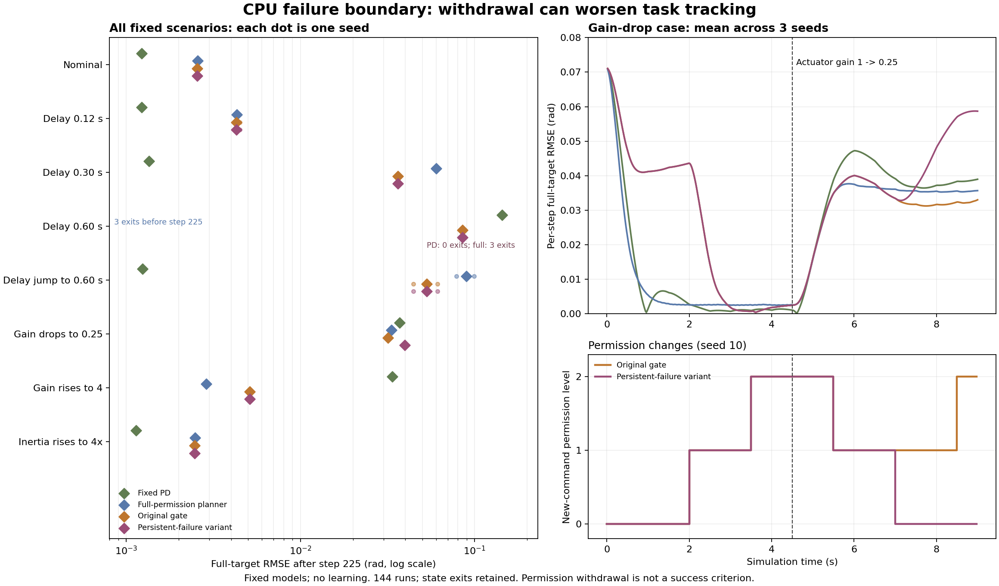

# CPU 无训练失效边界与门控响应：实测结果

本轮发现了固定模型控制的实际失效边界，也发现了新退级规则的不利结果：0.60 s 恒定延迟使完整权限规划器在三个种子中全部触及位置退出界限；“连续三个表现失败窗口后退级”的变体，在执行器增益降低时反而使突变后跟踪误差增加 24.86%。能力门控可以改变控制权限，但本批结果不支持把更多退级等同于更好的控制。

实验遵循结果产生前冻结的 [失效边界协议](CPU_FAILURE_PROTOCOL.md)。仅使用 CPU，模型与策略参数更新均为 0；没有运行 PPO、监督拟合或递推辨识。协议 commit 为 [`28723a5`](https://github.com/ruirui688/developmental-humanoid-learning/commit/28723a5)，运行源代码 commit 为 [`357a279`](https://github.com/ruirui688/developmental-humanoid-learning/commit/357a2799c6329108497d94c73e3bbae7a6dbc97b)，运行时 Git 工作区干净。配置、模型和源文件的运行前后指纹一致。

## 1. 数据与预算

采用种子 `10, 11, 12`、8 个预先固定场景和 6 个方法，共 **144 次运行**。每次最多 450 步，步长 0.02 s；总上限 64,800 步，实际执行 **63,887 步**。其中 140 次完成预算、4 次因状态限位提前终止、0 次非有限状态退出。报告内运行耗时为 **69.07887 s**，不包含后续归档、绘图等操作。

短时域候选规划执行了 31,865,260 次内部模型状态推进，另有 63,887 次用于残差记录的单步模型预测。它们与真实仿真交互分别计账，不能把内部预测次数当作机器人真实交互，也不能忽略它们的计算成本。

运行环境为 Python 3.10.11、NumPy 1.26.4、Windows，设备 CPU，GPU 字段为空。没有重置后的共同权限评估；指标来自同一条连续轨迹，突变时保留状态与历史命令。

原始数据和复核入口：

- [归档说明](../results/cpu_validation/2026-10-10_failure_boundary/README.md)与[校验清单](../results/cpu_validation/2026-10-10_failure_boundary/manifest.json)。
- [逐运行报告与窗口证据](../results/cpu_validation/2026-10-10_failure_boundary/report.json)。
- [原门控及变体的全部事件](../results/cpu_validation/2026-10-10_failure_boundary/gates.json)。
- [逐步轨迹 CSV 压缩包](../results/cpu_validation/2026-10-10_failure_boundary/trace.csv.gz)与[运行源文件快照](../results/cpu_validation/2026-10-10_failure_boundary/source_snapshot.zip)。
- [冻结数据绘图脚本](../scripts/plot_cpu_failure_boundary.py)。

归档后由另一位审查智能体用独立实现复核：手写 Euler 状态推进与名义单步预测逐项比对全部 63,887 步，最大绝对差为 0；历史命令索引、有效力矩、2,557 个窗口、864 个门控事件、逐运行聚合、文档 72 个 RMSE 数字和源码校验值均一致。复核仅做离线重算，没有重跑控制矩阵或训练；它检验数据和实现的一致性，不构成外部团队复现实验。

## 2. 全目标跟踪结果

下表为每个种子实际执行步上的两关节目标 RMSE，再对三个种子取算术平均，单位 **rad**。活动关节的门控误差在原始报告中单独保存；下表始终包含尚未开放的关节。早停项只计算实际执行轨迹，因此必须结合退出次数判断，不能当作完成 450 步后的公平成功成绩。

| 场景 | 零命令 | 固定 PD | 完整权限规划 | 固定成熟 | 原能力门控 | 持续失败退级变体 |
|---|---:|---:|---:|---:|---:|---:|
| 名义匹配 | 0.068008 | 0.013526 | 0.012442 | 0.021495 | 0.023807 | 0.023807 |
| 恒定延迟 6 步 | 0.068008 | 0.015016 | 0.014199 | 0.022905 | 0.025076 | 0.025076 |
| 恒定延迟 15 步 | 0.068008 | 0.018619 | 0.055501 | 0.049570 | 0.043360 | 0.043360 |
| 恒定延迟 30 步 | 0.068008 | 0.112888 | 0.142513，3/3 退出 | 0.138617，1/3 退出 | 0.078010 | 0.078010 |
| 延迟 0→30 步 | 0.068008 | 0.013527 | 0.064637 | 0.073056 | 0.044449 | 0.044449 |
| 增益 1→0.25 | 0.068008 | 0.029463 | 0.026484 | 0.031789 | 0.032711 | **0.036784** |
| 增益 1→4 | 0.068008 | 0.027292 | 0.012477 | 0.021509 | 0.024013 | 0.024013 |
| 惯量 ×4 | 0.068226 | 0.013522 | 0.012433 | 0.021490 | 0.023803 | 0.023803 |

名义匹配和 6 步延迟中，权限逐步开放增加了全目标误差；完整权限规划和固定 PD 更早控制两个关节。15 步延迟中，两个门控的误差小于完整权限与固定成熟规划，但仍大于固定 PD。30 步延迟中，门控未退出却也没有获得两个关节的控制能力，误差甚至高于零命令参照。

四个突变场景的**突变后** RMSE 如下，每次都实际执行 225 个突变后步骤：

| 突变场景 | 零命令 | 固定 PD | 完整权限规划 | 固定成熟 | 原能力门控 | 持续失败退级变体 |
|---|---:|---:|---:|---:|---:|---:|
| 延迟 0→30 步 | 0.067963 | 0.001236 | 0.089714 | 0.098773 | 0.053040 | 0.053040 |
| 增益 1→0.25 | 0.067963 | 0.037029 | 0.033156 | 0.033215 | 0.031824 | **0.039735** |
| 增益 1→4 | 0.067963 | 0.033537 | 0.002883 | 0.002779 | 0.005110 | 0.005110 |
| 惯量 ×4 | 0.068399 | 0.001134 | 0.002481 | 0.002475 | 0.002462 | 0.002462 |

延迟突变发生时固定 PD 已接近目标、命令变化较小，因而本场景仍有良好跟踪；从初态就带 30 步延迟的 PD 则明显退化。这揭示了控制起点与命令历史的影响，不能将已接近目标时的扰动适应称为冷启动技能获得。惯量 ×4 同样发生在接近目标的阶段，本批未使门控触及失败阈值；它不证明系统已认识或学会补偿新惯量。

## 3. 确认的失效边界

恒定 30 步延迟为 0.60 s，比规划器 20 步、0.40 s 的名义预测时域更长，而且固定模型假设动作立即执行。该配置下完整权限规划器的三个种子均因位置越界结束；固定成熟有一个种子越界。

| 方法 | 种子 | 已执行步数 | 退出时间 | 最后不足窗口步数 |
|---|---:|---:|---:|---:|
| 完整权限规划 | 10 | 193 | 3.86 s | 18 |
| 完整权限规划 | 11 | 189 | 3.78 s | 14 |
| 完整权限规划 | 12 | 189 | 3.78 s | 14 |
| 固定成熟 | 12 | 316 | 6.32 s | 16 |

上述退出时速度仍低于 1.2 rad/s；触发的是位置界限，而非数值非有限或速度界限。独立状态检查直接结束运行，最后不足窗口的证据保留但没有输入门控。它们是试验系统的限位退出，不是人形机器人跌倒，更不是硬件急停验证。

两个门控在恒定 30 步延迟下三个种子都始终留在第 0 档，只控制一个关节。没有晋级、没有实际退级；最低档仍有失败窗口。零命令在该稳定弹簧阻尼系统中也没有退出，且全目标 RMSE 为 0.068008，小于门控的 0.078010。因此本场景的“未触及退出界限”只能与权限、误差一起解释，不能记为任务成功或门控安全优势。

## 4. 新退级规则的负结果

预先定义的持续失败退级变体只在 **增益 1→0.25** 场景产生不同控制轨迹；其他七个场景的行为与原门控一致。该场景三个种子均出现同一事件顺序：

1. `step = 225` 开始采用较弱执行器增益。两方法此前均已开放第 2 档。
2. 完成 275 步时，两者因预测失配从第 2 档退至第 1 档，即突变后 1.0 s。
3. 原门控随后在第 1 档经历三个跟踪表现失败窗口，继续保持权限；固定模型和所有阈值均不更新。
4. 新变体在完成 350 步时因这三个连续窗口撤回至第 0 档，随后持续停留在该档。原门控后续表现满足阈值，于完成 425 步时重新晋级至第 2 档。

突变后全目标 RMSE 从原门控的 **0.031824 rad** 增至变体的 **0.039735 rad**，增加 **24.86%**。整段 RMSE 从 0.032711 增至 0.036784。两者均无状态退出；变体并未换得更少的退出。

按各关节命令权限限额对时间积分，整条 9 s 轨迹中原门控为每次 12.1，变体为 9.8；仅突变后 4.5 s 分别为 7.2 和 4.9，单位为本模型力矩单位乘秒。这个积分反映允许的动作范围，不是实际力矩冲量或能耗。变体减少权限却损害跟踪；撤回第 0 档还关闭了第二关节的主动控制，因此不能把权限积分下降包装成效率改善。

原门控共发生 51 次晋级、24 次实际退级；变体为 48 次晋级、27 次实际退级。新增 3 次实际退级全部来自增益下降场景，另有 3 次持续失败触发发生在最低档，只产生保持事件。这些计数确认状态机按预定规则运行，同时提供否定“持续表现失败一律撤回权限会提高控制”的证据。本批不将变体替换为默认算法，不根据结果调整阈值或失败窗口数。

## 5. 检测、权限撤回与真实执行作用

四个突变场景在突变开始时，两个门控均处于第 2 档。下表为首次突变后完整失败窗口被门控观察到，并实际退回一级的延迟；两种门控首次响应一致。

| 突变场景 | 种子 10 | 种子 11 | 种子 12 | 首次退级原因 |
|---|---:|---:|---:|---|
| 延迟 0→30 步 | 1.5 s | 2.5 s | 2.0 s | 预测失配 |
| 增益 1→0.25 | 1.0 s | 1.0 s | 1.0 s | 预测失配 |
| 增益 1→4 | 0.5 s | 0.5 s | 0.5 s | 预测失配 |
| 惯量 ×4 | 未达到失败阈值 | 未达到失败阈值 | 未达到失败阈值 | 无退级 |

延迟按照“已完成步数减 225”计算，门控决定从下一次命令生效。突变前第一个低档窗口中已有的失败另行计量，不算突变检测。上述所有首次响应均来自门控确实观察的完整窗口；提前状态退出与不足窗口不混记为门控检测。

全部新发出的控制命令都满足当前档位和硬命令限额，**命令违规步数为 0**。然而，延迟系统在退级后仍可执行较高档位的历史命令：

| 场景 | 原门控实际历史命令超当前权限步数 | 变体步数 | 每方法逐种子计数 |
|---|---:|---:|---|
| 恒定延迟 15 步 | 90 | 90 | `30, 30, 30` |
| 延迟 0→30 步 | 84 | 84 | `30, 26, 28` |

这些步数由真实执行历史命令相对于当前权限计算，不能当作当前新命令违规，也不能因软件门控已退级就省略。此处延迟采用 `command[t-delay]` 历史索引，延迟突增会重复读取旧命令；它是冻结的诊断抽象，不代表真实通信队列模型。

增益 1→4 场景中，实际有效控制力矩为 `gain × applied_command`，未再夹紧。最大值为 1.333333，超过名义硬**命令**限额 1.2。三种子合计的超限步数如下：完整权限规划 199、固定成熟 210、原门控 71、变体 71；固定 PD 和零命令为 0。两种门控的这一计数低于完整权限规划，但跟踪误差也更大，且所有方法都无状态退出。这仅是本场景的暴露与误差权衡，不能解释为经过验证的硬件力矩保护。

## 6. CPU 运行性与研究决策

本批最高的逐运行动作选择耗时 p95 为 3.003 ms，低于 20 ms 的仿真步长；仍有 **1 次**动作选择超过步长，为 36.007 ms，发生在延迟突变、原门控、种子 11 的第 411 步。计时不含仿真、窗口聚合和通信，因此可确认本规模的离线 CPU 验证可运行，不能据此承诺真机实时性。

当前结论是：

- 固定控制已有能力，名义场景下逐步开放权限有性能成本；它不是“从零学会控制”的结果。
- 未建模延迟可导致明显退化和限位退出，固定模型需要知道执行历史，或通过后续辨识减少失配。
- 预测失配驱动的门控在本批能产生实际退级，但撤回权限存在窗口检测与延迟执行的滞后。
- 仅按持续跟踪失败继续退级，在较弱执行器场景中损害控制，不能作为默认改进。
- 惯量突变在已接近目标的阶段未暴露失败，后续评估需要区分稳定保持、动态跟踪和技能获得。

本轮交付是可复核的失效边界与响应证据，尚未建立“少量动作反馈 → 身体知识更新 → 控制改善”的学习链条。当前仍保持 CPU、暂不训练。下一批可先设计冻结模型对执行历史的显式处理与失败原因分类；在线辨识必须在用户明确要求开展学习实验后，使用同初始化冻结模型和适当经典控制对照，才能评价学习的净收益。后续更真实的重力与接触任务另立协议，不能将本双关节诊断直接外推为 G1 或真机能力。
