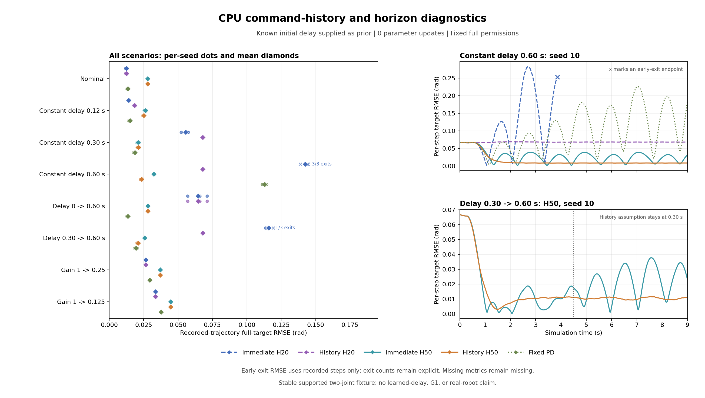

# CPU 无训练指令历史与预测时域：实测结果

本批确认：在相同 50 步预测时域下，使用自己已发出的指令历史与事先声明的 30 步延迟，使恒定延迟场景的全目标误差降低 **27.58%**；但历史建模没有普遍改善跟踪，延长时域也使名义匹配和执行器增益下降场景恶化。20 步历史规划在三个场景中持续输出零命令，低残差和没有退出并不等于任务成功。

实验遵循结果产生前冻结的 [指令历史与预测时域协议](CPU_HISTORY_PROTOCOL.md)。运行源代码为 [`9829e6b`](https://github.com/ruirui688/developmental-humanoid-learning/commit/9829e6ba7f6e7ea149b1e15188bf6275b5443c84)，运行时工作区干净。只使用 CPU；模型、策略与延迟参数更新次数均为 **0**，没有运行 PPO、监督拟合或递推辨识。固定模型、配置与源码的运行前后指纹一致。

`history` 获得额外的、公开声明的初始延迟先验；它没有从数据学习延迟，也不会在参数突变后更新声明值。本批只能说明固定模型对已知初始指令时序的处理及其控制后果，不能算作在线学习收益、冷启动技能获得或未知参数适应成功。

## 1. 数据与计算预算

8 个场景 × 3 个种子（10、11、12）× 5 个方法，共 **120 次运行**。每次最多 450 步、步长 0.02 s，总预算上限 54,000 步；实际执行 **53,179 步**，116 次完成、4 次位置界限退出、0 次非有限状态退出。报告内运行耗时 **168.4671654 s**，不包含归档、绘图或复核。

候选搜索共推进 **73,283,420 个内部模型状态**，另有 **159,537 次诊断单步预测**，即每次实际 transition 分别计算方法因果预测、公共立即执行预测与作用命令标签预测。这些计算均不计为真实仿真交互，但需独立披露计算成本。环境为 Python 3.10.11、NumPy 1.26.4、Windows、CPU；GPU 字段为空。

原始数据与复核入口：

- [归档说明](../results/cpu_validation/2026-10-10_history_horizon/README.md)与[校验清单](../results/cpu_validation/2026-10-10_history_horizon/manifest.json)。
- [逐运行报告、分阶段指标与成对比较](../results/cpu_validation/2026-10-10_history_horizon/report.json)。
- [逐步轨迹压缩 CSV](../results/cpu_validation/2026-10-10_history_horizon/trace.csv.gz)与[源文件快照](../results/cpu_validation/2026-10-10_history_horizon/source_snapshot.zip)。

另一位审查智能体完成独立离线核验：手写 Euler 推进与三种残差，复算全部 53,179 步的动力学、指令历史索引、阶段指标和 96 个共同前缀成对指标；共比对 765,434 个数值，最大绝对差为 0。快照内 9 个源文件与上述 commit 的 Git blob 一致。复核未重跑控制矩阵，没有训练；这是仓库内数据与实现一致性审查，不构成外部团队复现。

## 2. 全目标跟踪结果

下表在每个种子实际执行轨迹上计算两关节目标 RMSE，然后对三个种子取算术平均，单位 **rad**。所有方法始终使用最高档固定权限，两关节命令限额均为 1.0；不启用成熟或能力门控。早停项只包含实际执行步，必须结合退出次数阅读，不能作为完整 450 步任务成绩。

| 场景 | immediate H20 | history H20 | immediate H50 | history H50 | 固定 PD |
|---|---:|---:|---:|---:|---:|
| 名义匹配 | 0.012442 | 0.012442 | 0.027933 | 0.027933 | 0.013526 |
| 恒定延迟 6 步 | 0.014199 | 0.018437 | 0.026309 | 0.025050 | 0.015016 |
| 恒定延迟 15 步 | 0.055501 | 0.068008 | 0.020894 | 0.021175 | 0.018619 |
| 恒定延迟 30 步 | 0.142513，3/3 退出 | 0.068008 | 0.032391 | 0.023457 | 0.112888 |
| 延迟 0→30 步 | 0.064637 | 0.064637 | 0.028119 | 0.028119 | 0.013527 |
| 延迟 15→30 步 | 0.115884，1/3 退出 | 0.068008 | 0.025745 | 0.020961 | 0.019413 |
| 增益 1→0.25 | 0.026484 | 0.026484 | 0.037105 | 0.037105 | 0.029463 |
| 增益 1→0.125 | 0.033492 | 0.033492 | 0.044517 | 0.044517 | 0.037650 |

H20 为 0.40 s、H50 为 1.00 s。名义匹配时，两种执行假设在同一时域完全一致，但 H50 的整段误差从 0.012442 增至 0.027933 rad，三个种子均恶化。H50 的名义控制命令峰值只有约 0.333333，而 H20 各种子达到 0.666667 或 1.0；这显示两种规划配置选择了不同的动作，不能把更长预测时域自动解释为更强的控制。

四个突变场景的突变后结果如下。突变从 0-based `command_step=225` 开始；保留此前状态和全部命令历史。

| 场景 | immediate H20 | history H20 | immediate H50 | history H50 | 固定 PD |
|---|---:|---:|---:|---:|---:|
| 延迟 0→30 步 | 0.089714 | 0.089714 | 0.027100 | 0.027100 | 0.001236 |
| 延迟 15→30 步 | 0.158587 | 0.067963 | 0.023555 | 0.010522 | 0.007889 |
| 增益 1→0.25 | 0.033156 | 0.033156 | 0.043665 | 0.043665 | 0.037029 |
| 增益 1→0.125 | 0.044046 | 0.044046 | 0.055825 | 0.055825 | 0.049699 |

延迟 15→30 的 immediate H20 在种子 10 只执行 183 个突变后步骤，另两个种子各 225 步；其余表项各三个种子均执行 225 步。因此该行不同方法的突变后误差并非完全相同长度的评估。共同前缀比较另存于报告，不能把未执行尾段当作成功或零误差。

延迟 0→30 的 history 组声明值始终是 0，增益下降场景也不更改名义增益；同一时域的 history/immediate 因而产生相同命令和状态。H50 在延迟 0→30 下的改善来自整体时域配置变化，不来自历史建模或延迟识别。固定 PD 在突变前已接近目标，其突变后结果不代表从同一冷启动状态学会控制。

## 3. 同一时域的历史效应与负结果

下面使用报告中的逐种子共同前缀成对指标，再取三个种子的算术平均。列出的 H50 组均完整执行 450 步；正的“误差相对减少”表示 history 更低，负值表示更高。预测残差为位置与速度归一化后的四维 RMSE，无 rad 单位。

| 场景，H50 | immediate 全目标 RMSE | history 全目标 RMSE | 误差相对减少 | immediate 因果预测残差 | history 因果预测残差 |
|---|---:|---:|---:|---:|---:|
| 恒定延迟 6 步 | 0.026309 | 0.025050 | +4.79% | 0.002041 | 0.000426 |
| 恒定延迟 15 步 | 0.020894 | 0.021175 | -1.35% | 0.002865 | 0.000426 |
| 恒定延迟 30 步 | 0.032391 | 0.023457 | +27.58% | 0.003460 | 0.000426 |
| 延迟 15→30 步 | 0.025745 | 0.020961 | +18.58% | 0.003151 | 0.002050 |

恒定 30 步延迟下，主要同 H50 比较为 **0.032390846 → 0.023456797 rad**，减少 **27.58%**；三个种子都完成预算。该对照在相同时域内单独改变执行假设，支持在本场景中使用已知初始延迟和自有命令历史改善控制。与此同时，恒定 15 步延迟的 H50 跟踪误差恶化 1.35%，不能宣称历史方法普遍优于立即执行假设。

H20 下，恒定 6 步与 15 步延迟的 history 整段跟踪误差分别增加 29.84% 和 22.54%，即使预测残差显著降低，也没有带来更好的目标控制。预测正确性与动作选择质量是两个需要分别检验的问题。

三个 H20 历史组的实际零命令结果：

| 场景 | 声明延迟 | 候选可影响的预测 transition 数 | 零命令步数 / 实际步数 | 零命令回退步数 |
|---|---:|---:|---:|---:|
| 恒定延迟 15 步 | 15 | 5 | 1,350 / 1,350 | 0 |
| 恒定延迟 30 步 | 30 | 0 | 1,350 / 1,350 | 0 |
| 延迟 15→30 步 | 15，突变后不改 | 5 | 1,350 / 1,350 | 0 |

30 步声明延迟超过 H20，当前候选在预测状态中完全尚未生效，状态成本无法区分候选，零初始命令下努力与变化成本持续选择零。这是时域不足的机制诊断。15 步声明延迟仍有 5 个预测 transition 受候选影响，却也持续选择零，因此不能把另外两组零命令都归因于“候选完全未生效”；成本、常值候选假设和动作离散化仍需独立诊断。

这些零命令不是候选全部不可行的 fallback，日志中 fallback 为 0。全目标误差约 0.068008 rad，接近不施加控制的稳定弹簧阻尼系统响应；没有退出与低预测残差都不能算作学会跟踪。尤其不能把 history H20→H50 的改善全归因于历史：时域、候选有效作用步数、累计成本和内部计算量同时改变。

## 4. 未知变化：时序失配与物理作用不足

延迟 15→30 中，history H50 只知道最初的 15 步延迟。其突变后因果预测残差为 0.002867，离线使用实际作用命令标签的残差为 0.000426；使用正确作用时序后剩余误差与未建模周期外力一致。这支持将差额诊断为时序失配，而不是宣称控制器识别了新的延迟。实际作用命令标签只用于 transition 后的离线分析，不进入动作选择。

增益 1→0.25 与 1→0.125 中，H50 的突变后因果残差分别为 0.003249 和 0.003802；使用实际作用命令标签后两者仍保持相同数值。这里执行时序正确，但名义模型仍使用增益 1，换用命令标签不能消除动力学失配。H50 的突变后目标误差也分别从 H20 的 0.033156、0.044046 增至 0.043665、0.055825 rad；两种增益下降场景的三个种子整段误差均恶化。

忽略周期外力，在固定目标处离线计算静态所需命令：`u = (stiffness × target + coupling × (target - reverse(target))) / gain`。

| 实际增益 | 静态所需命令 | 中档限额 0.7 | 本批全权限限额 1.0 | 硬命令限额 1.2 |
|---|---|---|---|---|
| 1 | `(0.245, -0.213)` | 可达 | 可达 | 可达 |
| 0.25 | `(0.980, -0.852)` | 不可达 | 可达 | 可达 |
| 0.125 | `(1.960, -1.704)` | 不可达 | 不可达 | 不可达 |

0.25 场景中目标仍在本批全权限范围内，但超过 [上一批](CPU_FAILURE_RESULTS.md) 中档限额，表明退级后的权限不足可以与固定模型失配同时存在。0.125 则连硬命令限额都不足以保持静态目标，构成物理作用不足的对照。静态可达并不保证当前离散规划器能稳定达到目标，也不包括周期外力的瞬态需求；这张表是事后诊断，不能用于修改控制器或制造额外先验。

## 5. 退出与计算时间

本批 4 次退出均为位置越界：

| 场景 | 方法 | 种子 | 实际执行步数 | 退出时间 |
|---|---|---:|---:|---:|
| 恒定延迟 30 步 | `immediate_h20` | 10 | 193 | 3.86 s |
| 恒定延迟 30 步 | `immediate_h20` | 11 | 189 | 3.78 s |
| 恒定延迟 30 步 | `immediate_h20` | 12 | 189 | 3.78 s |
| 延迟 15→30 步 | `immediate_h20` | 10 | 408 | 8.16 s |

这些是受支撑双关节试验模型的状态界限退出，不是 G1 跌倒或真机急停。其余方法没有退出，也仍须结合目标误差与实际命令评价。前一批的 4 次退出包含固定成熟方法，本批取消了成熟且增加延迟突变场景，两批退出清单不能混写。

最高逐运行动作选择 p95 为 **12.251675 ms**，所有动作选择中的最大值为 **88.136600 ms**；共 **37 步**超过 20 ms 的仿真步长。时间只包含动作选择，不包含通信、状态读取、仿真推进或残差诊断；本批不作 50 Hz 实时控制承诺。H50 的每步 2,450 个内部模型状态推进高于 H20 的 980 个，计算代价也不能算作免费改进。

## 6. 研究决策与下一步

保留原规划器、门控和本批全部对照，不把 H50 或历史规划无条件替换为默认方案。本批建立了可审查的指令时序处理，也暴露了成本与动作选择在短有效时域内的控制不足；当前证据支持继续拆解机制，尚不支持宣称机器人通过学习获得身体认识。

下一步仍做 CPU 无训练验证：冻结新的诊断协议，在相同时域和命令权限下，分别比较成本定义与候选离散化，检查 15 步延迟下为什么 5 个有效预测 transition 仍持续选择零，并检查名义 H50 的低幅命令是否由常值候选与累计成本共同导致。每次只改变一个因素，不根据漂亮结果继续延长时域或挑选种子；保留不利结果及内部计算账目。

之后的延迟估计、增益辨识或 RLS/ARX 等在线参数更新属于学习阶段，需用户明确要求开展学习实验后才启用。当前模型是稳定、有外部支撑的双关节弹簧阻尼系统，没有刚体接触、人形姿态或真实机器人验证；不能外推至 G1、多技能积累或无保护真机学习。
