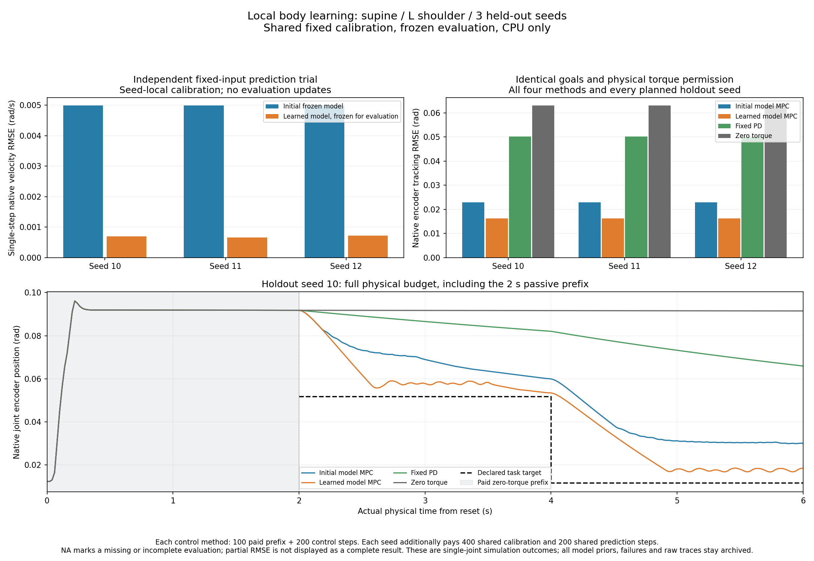

# CPU 局部身体学习：第二版通过初期预测与闭环验收

> 2026-10-11；真实刚体接触的自建简化身体，CPU；不使用 PPO、步态教师、预训练策略或真机。

用户已允许少量在线辨识。本轮先完成动作—感觉前置验收，再检查少量身体模型更新能否改善预测和闭环。局部关节结果不能证明翻身、起身、站立或行走学习；旧二维与 G1 证据仍分开报告。

## 1. 固定单关节探针可以获得重复响应

按 [探针协议](JOINT_PROBE_PROTOCOL.md) 完成开发与留出各 300 trials：四姿态、三 seed、八关节、三幅度，以及每个初态一条真实共享零力矩对照。合计 **120,000 控制调用 / 1,200,000 物理子步**；其中前缀 60,000 / 600,000，脉冲窗口 15,000 / 150,000，恢复窗口 45,000 / 450,000。0 停止、0 异常、0 参数更新。墙钟分别为 170.57 s、189.34 s。

两个 split 的全部 576 个脉冲配对都有精确相同的零力矩前缀。共有 **20/32 个姿态/关节组合**在 0.5 N·m 下，全部六个 seed 的脉冲末端有符号配对响应达到预先固定的 1 mrad 门。其他组合和三剂量完整保留，门只表示理想传感模型中的局部响应，不表示安全或学习成功。

依照开发集预定顺序选中仰卧左肩；没有选最大响应，也没有用留出结果改选。

| seed | split | 0.5 N·m 脉冲末端沿请求方向的配对关节变化 / rad |
|---:|---|---:|
| 0 | development | 0.030990 |
| 1 | development | 0.030363 |
| 2 | development | 0.031423 |
| 10 | holdout | 0.029933 |
| 11 | holdout | 0.029762 |
| 12 | holdout | 0.030219 |

独立标准库审计 **47,944,690 项、0 失败**，最大重算差 `3.13e-13`。实际物理/动作/协议的九个核心文件跨 split 字节一致；开发源提交 `61df2d0`，留出为 `fadef21`，唯一源码差异是探针不调用的学习 runner 失败计账修复。两份源码 ZIP 全部成员都与各自 Git blob 原字节一致。

## 2. 第一版：控制改善，预测反而退化

按 [第一版 E1 协议](LOCAL_BODY_LEARNING_PROTOCOL.md) 从 clean `fadef21` 执行三个开发 seed。每 seed 用 2 s 真实零前缀、6 s 固定双向校准，更新四参数线性 ARX/RLS；随后冻结全部参数，用独立真实 reset 比较预测与控制。没有使用下一时刻实际力矩作预测特征，没有接触或惯量真值输入。

| seed | 冻结速度预测 RMSE / rad/s | 学习后速度预测 RMSE / rad/s | 冻结 MPC 跟踪 RMSE / rad | 学习后 MPC / rad | 固定 PD / rad | 零力矩 / rad |
|---:|---:|---:|---:|---:|---:|---:|
| 0 | 0.005007 | 0.006189 | 0.022606 | 0.015862 | 0.050050 | 0.063294 |
| 1 | 0.004999 | 0.006012 | 0.022881 | 0.016116 | 0.050130 | 0.063154 |
| 2 | 0.005013 | 0.006248 | 0.022117 | 0.015625 | 0.050013 | 0.063430 |

学习后 MPC 的三个 RMSE 均改善，原始 RMSE 均值降低 **29.59%**；但单步速度预测误差增加约 **20.27%–24.63%**，与预定“每 seed 至少改善 20%”相反。因此第一版没有通过完整学习验收。不能只挑控制表来宣称模型整体成功，也不能把预测退化改写成无关指标。

第一版正式开发成本 **5,400 控制步 / 54,000 子步、900 次 RLS 更新、14.61 s 墙钟**。全部 18 个 episode 完整执行，0 停止/异常。独立标准库审计 **2,141,463 项、0 失败**，重算 RLS、因果预测、全部 MPC 候选、PD、前缀、模型冻结、来源及预算。该审计确认记录可信；它没有宣称科研门通过。

因开发预测门未通过，**第一版学习留出尚未执行**。留出不是失败后删除的样本；不存在它的成功率或学习指标。开发负结果和代码快照完整归档。

## 3. 第二版在留出 seed 上同时改善预测与控制

小幅和较大幅度的身体响应不成线性比例。线性模型只用 ±0.5 N·m 校准，再预测 ±0.25 N·m 的独立轨迹，会混合接触约束、摩擦及身体耦合的作用。当前不能从这些数据唯一识别具体物理原因，也不能把模型系数称为测得的惯量。

按单独的 [第二版协议](LOCAL_BODY_LEARNING_V2_PROTOCOL.md) 检验一个五参数模型，增加 `sign(u)*max(abs(u)-0.25, 0)` 动作基函数，并在同样 300 个校准转移内覆盖三种幅度。0.25 N·m 是这次开发修订公开的结构选择；它没有被在线学习成接触阈值。

预测轨迹、控制目标、候选动作、时域、代价和 0.5 N·m 权限全部沿用第一版。源码与协议先提交并推送 `94ad34e`，再从同一干净提交分别运行开发 seed 0/1/2 与留出 seed 10/11/12。每个 seed 从名义模型重新开始，只在 300 个校准转移上做 RLS 更新；之后独立预测和四种控制评估全部冻结参数。第二版不继承第一版模型或数据，也不覆盖其负结果。

开发集独立预测误差降低 85.65%–86.22%，MPC 跟踪 RMSE 均值降低 29.53%。据此执行已经冻结的完整留出配方，没有根据留出改参数、加校准或删 seed。

| 留出 seed | 冻结速度预测 RMSE / rad/s | 学习后速度预测 / rad/s | 预测误差降低 | 冻结 MPC 跟踪 RMSE / rad | 学习后 MPC / rad | 固定 PD / rad | 零力矩 / rad |
|---:|---:|---:|---:|---:|---:|---:|---:|
| 10 | 0.004993 | 0.000693 | 86.13% | 0.022852 | 0.016313 | 0.050194 | 0.063074 |
| 11 | 0.004990 | 0.000664 | 86.69% | 0.022943 | 0.016332 | 0.050222 | 0.063045 |
| 12 | 0.004997 | 0.000721 | 85.57% | 0.022891 | 0.016199 | 0.050151 | 0.063126 |

三个留出 seed 均满足事前规定的预测误差至少降低 20%，学习后 MPC 跟踪误差逐 seed 低于冻结 MPC；原始跟踪 RMSE 均值从 **0.022895 降至 0.016281 rad，降低 28.89%**，超过规定的 20%。开发/留出全部 36 个 episode 完整，0 停止、0 异常、0 非有限/非法请求，评估零更新。

独立标准库审计 **4,325,251 项、0 失败**，最大重算差 `6.59e-13`；重算五维 RLS、全部因果预测、MPC 候选与动作、固定 PD、原生观测映射、前缀、参数冻结、源码来源及实际预算。数据一致性门和科研门分别通过。因此本轮完成的是 **CPU 单姿态、单关节身体模型学习与局部闭环的初期验收**。

图中预测柱仅对应独立固定输入 trial；下图包含付费的 2 s 零力矩前缀，展示完整时域和仍未消失的目标残差。它不是翻身、起身或行走视频。

## 4. 必须同时报告的不利结果和先验

**局部预测改善不能扩展为所有动作上的预测改善。** 在学习后 MPC 自己产生的轨迹上，学习模型的速度 RMSE 为 0.02437–0.02478 rad/s，同轨迹名义模型为 0.01708–0.01739 rad/s，学习模型反而差 **42.04%–44.46%**。零力矩轨迹上的名义模型误差约 `1.9e-8–3.1e-8 rad/s`，学习模型约 `0.000443–0.000555 rad/s`。校准后的偏置与局部线性状态项仍不能解释所有接触约束下的状态；控制改善不使这些失配消失。

学习后 MPC 实际绝对力矩积分约 1.7875–1.8025 N·m·s，冻结 MPC 约 1.680–1.685 N·m·s，增加约 6%–7%。共同 0.5 N·m 上限保证相同权限，不能据此宣称更省能耗或更安全。留出完整时域包括前缀的地面法向力峰为 553.41–554.45 N；肩关节没有触发限位屏蔽或规划回退，也不证明全身探索安全。接触力只作诊断，没有输入学习模型或规划器。

平方力矩努力增加约 11%–12%，触及最大权限为 134–136/200 控制步（冻结组 109–112/200），控制期动能峰增加约 30%。全部 36 个 episode 的最高地面力为 554.45 N，最大原生关节速度 4.262 rad/s、全身关节软限位超出最高 0.00808 rad；选中肩没有屏蔽不代表其他部位没有被动越界。完整派生指标见 [不利诊断](../results/cpu_validation/2026-10-11_local_learning/v2_secondary_diagnostics.json)。

固定 PD 在这项局部任务上更差，但它只是公开的 Kp=4、Kd=0.2 对照，未做独立开发调优，不能当作最强经典控制基线。本轮支持学习模型相对相同名义 MPC 的贡献，不能声称优于所有传统控制或 PPO。

初始结构仍包括自建身体、理想原生传感、公共关节限位、基础安全层、通用模型初始化、固定 0.25 N·m 折点、固定探索配方、手工目标和 MPC。没有任务教师、动作演示、预训练策略、特权动力学输入或奖励策略训练。三个 seed 来自同一模型与接触条件的轻微初态变化；未知载荷、延迟、摩擦、接触切换、双关节协调和真机仍未验证。v2 同时改变校准剂量与模型结构，两者贡献需要单独消融。

## 5. 少量更新与完整研发成本分开计账

每 seed 的学习部分为 **2 s 前缀 + 6 s 校准、300 次五参数 RLS 更新**；完整预测/四方法控制还需要额外交互。6 s 是仿真时间，不能解释为真实机器人已在 6 s 获得运动技能。

| 正式学习批次 | episodes | 控制调用 | 物理子步 | 模型更新 | 墙钟 / s |
|---|---:|---:|---:|---:|---:|
| v1 开发（预测门失败） | 18 | 5,400 | 54,000 | 900 | 14.61 |
| v2 开发 | 18 | 5,400 | 54,000 | 900 | 15.00 |
| v2 留出 | 18 | 5,400 | 54,000 | 900 | 15.05 |
| 合计 | 54 | **16,200** | **162,000** | **2,700** | **44.67** |

加上全部探针 120,000 控制调用 / 1,200,000 子步和此前四次地面采集 38,750 / 387,500，本轮正式地面物理研发累计 **174,950 控制调用 / 1,749,500 子步**，包括首次写盘中断和 v1 失败配方。测试、旧 NumPy 诊断、历史二维/G1 训练另列。共享校准/预测采集只计一次真实轨迹，但所有方法拥有的校准信息与预算均披露；不能把配对模型预测算作额外独立样本。

## 6. 可核查原始证据

- [探针开发配置与预算](../results/cpu_validation/2026-10-11_joint_probes/development/metadata.json)、[留出配置](../results/cpu_validation/2026-10-11_joint_probes/holdout/metadata.json)
- [探针开发全条件分析](../results/cpu_validation/2026-10-11_joint_probes/development_profile.json)、[留出全条件分析](../results/cpu_validation/2026-10-11_joint_probes/holdout_profile.json)
- [探针独立审计](../results/cpu_validation/2026-10-11_joint_probes/audit.json)、[外层校验清单](../results/cpu_validation/2026-10-11_joint_probes/manifest.json)
- [开发选择规则与输入 hash](../results/cpu_validation/2026-10-11_local_learning/selection.json)
- [第一版逐 seed 模型与指标](../results/cpu_validation/2026-10-11_local_learning/v1_development/seed_results.json)、[完整计划及实际 episode 账本](../results/cpu_validation/2026-10-11_local_learning/v1_development/episodes.json)
- [第一版原始预测/更新/物理轨迹](../results/cpu_validation/2026-10-11_local_learning/v1_development/trace.jsonl.gz)、[精确源码](../results/cpu_validation/2026-10-11_local_learning/v1_development/source_snapshot.zip)
- [第一版独立审计](../results/cpu_validation/2026-10-11_local_learning/v1_development_audit.json)、[学习外层校验清单](../results/cpu_validation/2026-10-11_local_learning/manifest.json)
- [第二版开发指标](../results/cpu_validation/2026-10-11_local_learning/v2_development/seed_results.json)、[留出指标](../results/cpu_validation/2026-10-11_local_learning/v2_holdout/seed_results.json)
- [第二版开发配置/预算](../results/cpu_validation/2026-10-11_local_learning/v2_development/metadata.json)、[留出配置/预算](../results/cpu_validation/2026-10-11_local_learning/v2_holdout/metadata.json)
- [第二版留出完整账本](../results/cpu_validation/2026-10-11_local_learning/v2_holdout/episodes.json)、[留出原始轨迹](../results/cpu_validation/2026-10-11_local_learning/v2_holdout/trace.jsonl.gz)、[精确源码](../results/cpu_validation/2026-10-11_local_learning/v2_holdout/source_snapshot.zip)
- [第二版联合独立审计](../results/cpu_validation/2026-10-11_local_learning/v2_audit.json)、[完整不利诊断](../results/cpu_validation/2026-10-11_local_learning/v2_secondary_diagnostics.json)、[全部探针热图](../results/cpu_validation/2026-10-11_local_learning/v2_probes.png)、[复现入口](../results/cpu_validation/2026-10-11_local_learning/README.md)

## 7. 下一步验证范围

优先解决闭环轨迹上的模型失配：在新开发协议中评价多步预测、校准覆盖与模型有效域，补充调优经典控制和校准/折点消融。之后验证一个新增关节与动力学扰动，再检验能力门控是否在相同完成标准下节省交互或风险。此前不扩大力矩权限、不声称已获得翻身/站立技能，也不将已使用的留出 seed 当作新版本的独立最终测试集。
