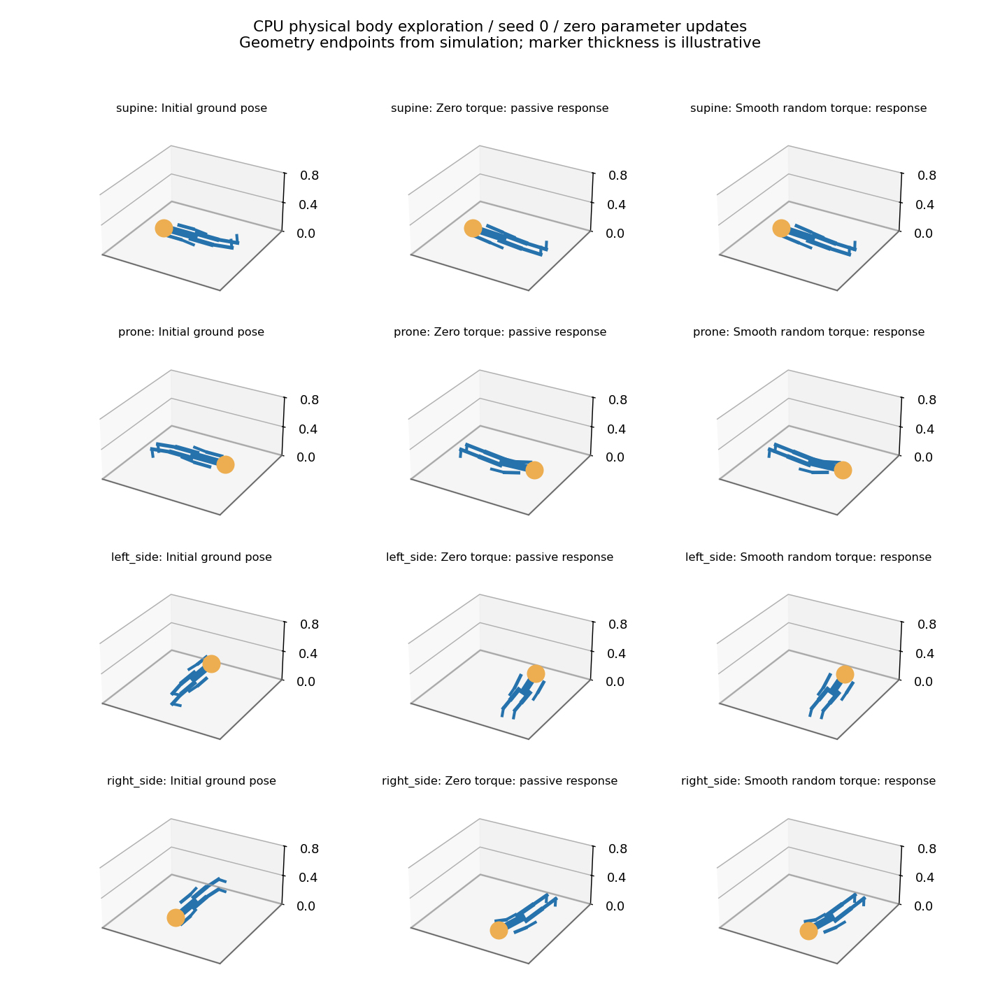

# CPU 地面身体探索：首轮无训练结果

> 2026-10-10；仅物理/采集诊断。模型、策略、门控参数更新均为 0。

完整矩阵从干净源码 `cf3c5cef15b812cd71708458cf40da467963b2bc` 运行，MuJoCo 3.15.0 CPU，四种躺姿 × 根 seed 0/1/2 × 零力矩/平滑随机探索。共 24 次试验，每次 250 个控制步、5 s：6,000 个控制步、60,000 个物理子步，24 次均完成，没有非有限状态或停止事件。归档墙钟 16.11 s 包含日志写盘，不是实时控制延迟验收。

首次从 `2a1de61` 开始的采集在写第 11 个几何检查点时出现 Windows 文件替换 `PermissionError`，保留 [原始中断归档](../results/cpu_validation/2026-10-10_ground_body/recovery.json)。该次已执行 2,750 控制步、27,500 物理子步，未计入完整矩阵；两次采集累计交互为 **8,750 控制步、87,500 物理子步**，没有删除重跑成本。初次完整耗时未成功落盘，不能报告精确累计墙钟时间。

## 1. 身体确实由物理推进



图为 seed 0，列从左至右是初态、5 s 零力矩被动响应、5 s 平滑探索响应。线段端点来自实际几何状态，绘图粗细仅用于显示。根部高度不是常量。即使零力矩，身体也会因重力、地面接触与形态产生关节变化和位移，所以这些变化不能单独算作学习或主动翻身。

物理与故障归档的 23 项测试通过；已有 188 项轻量 CPU 测试通过。物理测试包含无重力空中零命令静止、重力下落、真实接触力、单关节脉冲响应和空中水平动量/质心误差的步长收敛。另检查非法输入、力矩约束、停止锁存、固定参数、NaN/Inf 及写盘失败的保留路径。

## 2. 有动作响应，但尚未证明足够的学习激励

下表先在每个 seed 的 250 步轨迹上计算 RMS，再对 3 个 seed 求均值。关节变化相对于同一试验初态；成对差异比较同初态、同时间的探索组与零力矩组。

| 初态 | 零力矩关节变化 RMS / rad | 探索关节变化 RMS / rad | 成对轨迹差异 RMS / rad |
|---|---:|---:|---:|
| 仰卧 | 0.08517 | 0.08536 | 0.00581 |
| 俯卧 | 0.14521 | 0.14577 | 0.01360 |
| 左侧卧 | 0.15268 | 0.17666 | 0.06057 |
| 右侧卧 | 0.16184 | 0.17429 | 0.04241 |

仰卧/俯卧中的主动差异很小；侧卧差异更大也可能受到接触切换和被动转动影响。这是固定动作的响应诊断，不能据此认定身体模型可辨识、技能获得或方法样本高效。

3,000 个探索控制步中，2,141 步发生至少一次命令干预；30,000 个探索物理子步中，21,357 步（71.19%）有至少一个关节的向外力矩被限位保护屏蔽。这个比例不是“71.19% 的全部关节动作被屏蔽”。请求动作虽零均值，实际动作会因限位而偏置，不能默认已有充分激励。逐关节实际力矩 RMS、屏蔽比例和成对响应保存在 [excitation.json](../results/cpu_validation/2026-10-10_ground_body_verified/excitation.json)。

## 3. 零停止不等于安全探索已解决

控制终点采样得到最大关节速度 5.8313 rad/s、最大执行器力矩 0.21386 N·m、最大动能 4.1004 J；最大地面法向力总和 **895.07 N**，最小接触距离 −5.97 mm。接触是软约束求解，允许短时穿透；这些峰值只来自 20 ms 控制终点，不能当作全部 2 ms 物理子步的真实最大值。

当前停止器监测关节/动能/非有限值/求解器警告，没有接触冲击阈值。自然落地也可能产生较大力，因此本轮不能证明“低风险探索”，更不能把配置外推到真实机器人。

## 4. 下一步仍不训练

1. **先定位冲击来源。** 用原始轨迹区分最初被动落地、接触切换和主动动作；先补齐物理子步的接触峰值/冲量诊断，再决定是否比较接触柔顺性或更贴近地面的初态。修改身体、支撑或接触后单独记录，不混入本次冻结结果。
2. **检查有效激励。** 按关节/姿态/接触模式统计实际动作和响应，诊断是否主要受限位、地面摩擦或动作幅度限制；后续若比较可行范围内的单关节小脉冲与平滑随机动作，不提供步态或已会翻身的控制器。
3. **冻结身体预测协议。** 明确只读取原生信号和实际动作历史、按完整轨迹切分、记录探索与复位成本。当前不拟合模型；进入学习阶段后才比较同初始化的冻结/在线身体模型及其闭环净收益。

本阶段完成的是小孩式发育路线的物理与感知底座，尚未完成身体认识、能力门控、翻身或行走学习。

## 5. 复现与证据

- [配置、源码提交与依赖版本](../results/cpu_validation/2026-10-10_ground_body_verified/metadata.json)
- [逐次指标与全部 seed](../results/cpu_validation/2026-10-10_ground_body_verified/trials.json)
- [原始逐步轨迹](../results/cpu_validation/2026-10-10_ground_body_verified/trace.jsonl.gz)
- [源码原始字节快照](../results/cpu_validation/2026-10-10_ground_body_verified/source_snapshot.zip)
- [独立归档一致性审计](../results/cpu_validation/2026-10-10_ground_body_verified/audit.json)
- [最终文件校验清单](../results/cpu_validation/2026-10-10_ground_body_verified/manifest.json)
- [物理底座接口、先验与验收说明](GROUND_BODY_PHYSICS.md)

用原始轨迹重做描述统计与 CPU 绘图：

```powershell
python scripts/analyze_ground_body_archive.py results/cpu_validation/2026-10-10_ground_body_verified --output results/cpu_validation/ground_body_analysis_local.json
python scripts/plot_ground_body_collection.py results/cpu_validation/2026-10-10_ground_body_verified --output results/cpu_validation/ground_body_plot_local.png
python scripts/audit_ground_body_archive.py results/cpu_validation/2026-10-10_ground_body_verified --output external/ground_body_audit_local.json
```

独立标准库审计核对 1,696,520 项一致性/有限值检查，最大重算数值差 3.29×10⁻¹³；它不导入本项目环境，也不运行求解器。这证明归档一致，不是独立物理求解器验证、学习收益或硬件安全证明。`collection_manifest.json` 保留采集器最初 5 项文件的清单；最终 `manifest.json` 另覆盖后来添加的审计、统计和图。
