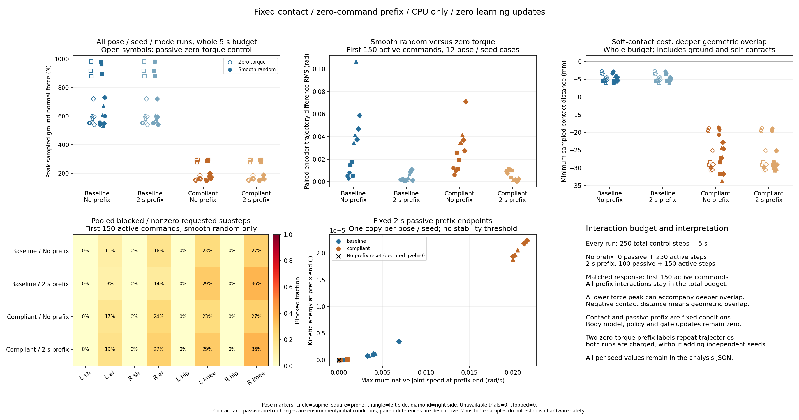

# 接触与前缀对照：降低力峰仍不足以得到有效身体探索

> 2026-10-10；CPU、零参数更新；[运行前冻结协议](GROUND_CONTACT_PREFIX_PROTOCOL.md)。

从干净提交 `e896170b5cce165c23806ebfd00d83a9f8ccc67c` 完成 96 次固定动作采集，24,000 控制调用、240,000 物理子步，480 s 仿真时间，墙钟 60.58 s。0 停止、0 异常、0 非有限标记，模型/策略/门控更新均为 0。这个结果没有建立身体模型或获得翻身、站立、行走技能。

## 1. 柔顺接触降低采样力峰，同时增加接触穿透

身体、力矩权限、摩擦和自碰撞参数保持原值；变体只修改地面接触时间常数与优先级。数值是自建简化模型的求解结果，不是实测软垫性能或硬件安全阈值。



| 接触 / 前缀 | 全 5 s 最大地面力峰 / N | 全 5 s 最小接触距离 / mm | 全 5 s 最大动能 / J | 共同窗口探索组最大力峰 / N | 配对关节轨迹差异 RMS 均值 / rad |
|---|---:|---:|---:|---:|---:|
| baseline / 0 s | 982.82 | −6.03 | 4.8039 | 979.68 | 0.031701 |
| baseline / 2 s | 982.82 | −6.03 | 4.6278 | 72.56 | 0.003677 |
| compliant / 0 s | 297.18 | −33.69 | 4.8026 | 296.78 | 0.027503 |
| compliant / 2 s | 297.18 | −30.74 | 4.6213 | 71.62 | 0.005253 |

全时域极值取各条件全部 24 个姿态/seed/动作组；最小距离包含地面和自碰撞接触，当前这个字段不能区分两者。共同窗口取各组前 150 次探索时段命令，0 s 前缀对应物理 0–3 s，2 s 前缀对应 2–5 s；力峰列只取随机探索的 12 次。最后一列为同条件探索/零力矩轨迹差异的逐试验 RMS，再对 12 个姿态/seed 配对取均值，不是成功率或学习精度。

地面力峰的组最大值约降低 69.76%，但最深接触穿透显著增大，动能峰值也没有相应消失。不能把只降低力峰称为更安全或更适合学习，当前不采用柔顺变体替换默认环境。2 ms 采样仍不是连续时间力峰上界；法向力积分包含持续承重。

## 2. 固定前缀避开初始瞬态，主动关节响应依然弱

2 s 零力矩前缀结束时，零力矩对照的最大动能为 baseline `3.46 × 10⁻⁶ J`、compliant `2.24 × 10⁻⁵ J`；最大关节速度分别为 `0.00691`、`0.02161 rad/s`，原生陀螺仪模长分别不超过 `0.00885`、`0.02121 rad/s`。这些是描述值，本轮没有“稳定成功”阈值。

前缀把初始落地留在预算内，**全程最大冲击没有因等待而减少**。它减少的是后续探索窗口受到初始瞬态的影响，同时少执行了 100 次探索命令。各条件共同 150 次随机命令的平均实际力矩 RMS 约为 `0.0614–0.0624 N·m`；没有因为前缀改变请求幅度。

| 姿态 | baseline / 0 s | baseline / 2 s | compliant / 0 s | compliant / 2 s |
|---|---:|---:|---:|---:|
| 仰卧 | 0.005542 | 0.002164 | 0.009317 | 0.009516 |
| 俯卧 | 0.012573 | 0.001518 | 0.018799 | 0.008139 |
| 左侧卧 | 0.060916 | 0.003929 | 0.036711 | 0.001862 |
| 右侧卧 | 0.047772 | 0.007098 | 0.045187 | 0.001495 |

表中为三 seed 的配对轨迹差异 RMS 均值（rad）。较大差异并不自动代表更可控或更可辨识；小幅命令也可能改变初始滚倒的时序。当前需要区分这种瞬态敏感性与接触形成后的、可重复的关节控制响应。

共同窗口内的限位屏蔽仍集中在肘、膝。baseline 的左右膝非零请求屏蔽比例从无前缀的 `22.58% / 27.24%`，变为有前缀的 `29.33% / 36.50%`；compliant 也没有消除这一现象。分母是各关节实际执行子步中的非零请求，不能混同先前“任一关节被屏蔽”的子步比例。逐关节力矩、积分、增量及端点接触数量分组保存在原始分析中。

## 3. 复现和预算没有被隐藏

baseline / 0 s 的 24 次、6,000 行状态、原生观测与全部旧诊断精确复现上一轮。零力矩的两个前缀标签下，24 个配对、6,000 行完整轨迹精确相同，属于重复对照；随机探索跨前缀的前 150 次请求也完全相同。前缀没有消耗动作随机流。

本轮前缀计账 4,800 控制调用 / 48,000 子步；探索时段 19,200 / 192,000（包括零力矩对照）。加上首次写盘中断及两次完整采集，四次采集总账为 **38,750 控制调用、387,500 物理子步、775 s 仿真时间**。正式采集与测试分开；0 停止不能用作安全证明。

60 项物理/遥测/归档检查通过；8 项离线分析检查通过；完整轻量 CPU 回归为 196 passed、5 个可选物理模块 skipped。独立标准库审计 7,406,963 项通过，最大标量重算差 1.82 × 10⁻¹²，核对全部源文件字节、逐关节计量、共同窗口和四次采集预算；审计没有执行仿真或拟合。新增穿透图只补齐结果呈现，不改变冻结协议、参数、分析窗口或计算指标。

## 4. 下一步仍不训练

先做固定的逐关节探针，确认在当前力矩上限、限位与地面接触下，哪些关节能产生可重复的感觉响应。候选是零力矩前缀后，按预定幅度/时长施加单关节小脉冲，记录实际力矩、限位屏蔽和原生关节变化；选择方向可以使用已披露的关节限位与编码器，须与零力矩配对，前缀和全部探针计入预算。

不提高当前 0.5 N·m 上限、不加入目标姿势或步态教师、不把脉冲响应称为学会动作。先区分动作分布、执行器权限与接触/限位造成的响应不足，再制定身体预测和后续学习协议；当前不拟合预测器、不更新模型或策略、不晋级能力。

## 原始证据

- [配置、源码、协议与依赖](../results/cpu_validation/2026-10-10_contact_prefix/metadata.json)
- [全部逐试验和逐关节分析](../results/cpu_validation/2026-10-10_contact_prefix/contact_prefix_profile.json)
- [原始轨迹与子步遥测](../results/cpu_validation/2026-10-10_contact_prefix/trace.jsonl.gz)
- [实际接触配置与逐次计账](../results/cpu_validation/2026-10-10_contact_prefix/trials.json)
- [精确源码与冻结协议快照](../results/cpu_validation/2026-10-10_contact_prefix/source_snapshot.zip)
- [独立标准库审计](../results/cpu_validation/2026-10-10_contact_prefix/audit.json)
- [原采集清单](../results/cpu_validation/2026-10-10_contact_prefix/collection_manifest.json)与[最终校验清单](../results/cpu_validation/2026-10-10_contact_prefix/manifest.json)
- [原四面板图](../results/cpu_validation/2026-10-10_contact_prefix/contact_prefix_summary.png)（补充穿透与预算的六面板图另存，未覆盖）

采集与离线分析命令见冻结协议；输出到新目录，保留既有归档。

```powershell
python scripts/audit_ground_contact_prefix.py results/cpu_validation/2026-10-10_contact_prefix --reference results/cpu_validation/2026-10-10_ground_impacts --output external/contact_prefix_audit_local.json
```
