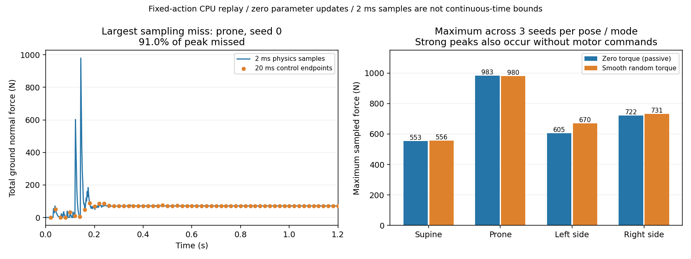

# 子步冲击诊断：运动没变，原来漏掉了峰值

> 2026-10-10；固定参数、零学习更新；协议见 [冻结设计](GROUND_IMPACT_PROTOCOL.md)。

从干净源码 `9772b3e93f35aaaaf63ad213247e1684b4e94690` 复现同一四姿态 × 三 seed × 两动作组，24 次全部完成，新增 6,000 控制步、60,000 物理子步，归档墙钟 14.22 s。与 [上一轮](GROUND_BODY_RESULTS.md) 的每一步 `qpos`、`qvel`、全部原生观测与实际子步命令精确相同，最大状态差为 **0**。新增的是 2 ms 特权诊断，不是控制器能力。

包含第一次写盘中断和两次完整矩阵，三次采集共 **14,750 控制步、147,500 物理子步**；模型、策略和门控参数更新仍为 0。

## 1. 20 ms 终点采样确实漏峰



全局 2 ms 采样最大地面接触法向力之和为 **982.82 N**，出现在零力矩俯卧组；上一轮 20 ms 终点的全局最大值为 895.07 N。这两个全局值的差异不能代替单次试验的遗漏程度。

遗漏最严重的是俯卧 seed 0 平滑探索：真实子步采样峰值 979.68 N，发生在 0.144 s；该试验所有控制终点的最大值只有 87.81 N，漏掉 **91.04%**。终点看似接近稳定承重，并不能证明中途没有强冲击。2 ms 采样本身仍不是连续时间上界。

## 2. 零力矩也有冲击，0.5 s 后仍可能被动滚倒

各行取对应三 seed 中最大子步采样值，不是组均值或安全阈值。

| 初态 | 零力矩采样峰值 / N | 平滑探索采样峰值 / N |
|---|---:|---:|
| 仰卧 | 553.50 | 556.33 |
| 俯卧 | 982.82 | 979.68 |
| 左侧卧 | 605.29 | 669.86 |
| 右侧卧 | 722.23 | 731.09 |

仰卧/俯卧的大峰值出现在初始落地阶段；侧卧所有试验的峰值发生在 **0.638–0.820 s**，包括全部六次零力矩对照。预先冻结的 0–0.5 s / 0.5–5 s 分窗保留，但后窗口不能被解释为“已经稳定后的纯主动探索”。不把事后重划窗口包装成预注册成功。

最大子步动能 4.8039 J，最小接触距离 −6.03 mm。法向力时间积分还包含稳定承重；例如俯卧 seed 0 探索的前 0.5 s 积分为 35.75 N·s，后 4.5 s 为 320.49 N·s，后段更大主要与时长和重力支撑有关，不能据此认定后段碰撞更严重。

## 3. 对学习路线的影响与下一步

当前有两个必须先处理的问题：**被动落地/滚倒造成较大冲击；实际探索命令经常被限位屏蔽且运动响应较弱。** 不能通过“未停止”证明安全，也不能把这些被动转移当作自主获得的动作。

下一项无训练对照先冻结：相同身体、相同权限与总控制步预算下，比对现有接触和明确披露的柔顺接触；同时检查先执行零力矩稳定前缀再开始探索是否减少瞬态污染。稳定前缀仍计入预算，观察到的稳定初态不能被称为学会翻身。先逐关节/接触模式看实际力矩与响应，再制定身体预测协议；当前不拟合模型、不晋级能力、不启动 PPO。

柔顺接触属于改变公共环境条件，所有动作组共享；它若降低冲击，收益归属于接触条件。不能把环境变软的收益算作学习算法优势，也不能单纯缩小动作来宣称提高能力。

## 4. 验证与原始证据

29 项物理/子步/故障归档测试通过。新增六项核对真实子步采样、提前停止的 0/1 子步预算、瞬态峰值和旧引擎回放，确认遥测不改变动作和原生观测。交付前再次运行轻量 CPU 回归，188 passed、3 个可选物理模块 skipped；物理检查在独立 MuJoCo 环境中执行。

独立标准库审计通过：通用归档核查 1,900,520 项，子步标量/时间窗/旧轨迹核查 528,481 项，最大重算差 1.364 × 10⁻¹²。核对全部 60,000 子步的三个遥测数组以及三次采集预算，不执行仿真或参数学习。原采集清单保存为 `collection_manifest.json`，最终 `manifest.json` 覆盖新增分析、图片及审计；审计记录中的原输入清单范围保持不变。

- [源代码、精确依赖和配置](../results/cpu_validation/2026-10-10_ground_impacts/metadata.json)
- [逐组子步峰值、冲量与时间窗](../results/cpu_validation/2026-10-10_ground_impacts/impact_profile.json)
- [原始逐步轨迹及全部子步遥测](../results/cpu_validation/2026-10-10_ground_impacts/trace.jsonl.gz)
- [精确源码快照](../results/cpu_validation/2026-10-10_ground_impacts/source_snapshot.zip)
- [通用归档审计原件](../results/cpu_validation/2026-10-10_ground_impacts/audit.json)（从报告所记 `external/ground_impacts_base_audit.json` 原字节复制）
- [独立子步审计](../results/cpu_validation/2026-10-10_ground_impacts/impact_audit.json)
- [保存审计脚本后的复核](../results/cpu_validation/2026-10-10_ground_impacts/impact_audit_recheck.json)（含脚本 SHA256）
- [原采集清单](../results/cpu_validation/2026-10-10_ground_impacts/collection_manifest.json)与[最终校验清单](../results/cpu_validation/2026-10-10_ground_impacts/manifest.json)

```powershell
python scripts/analyze_ground_body_impacts.py results/cpu_validation/2026-10-10_ground_impacts --reference results/cpu_validation/2026-10-10_ground_body_verified --output external/ground_impact_analysis_local.json
python scripts/plot_ground_body_impacts.py results/cpu_validation/2026-10-10_ground_impacts --output external/ground_impact_plot_local.png
python scripts/audit_ground_body_archive.py results/cpu_validation/2026-10-10_ground_impacts --interrupted-archive results/cpu_validation/2026-10-10_ground_body --output external/ground_impact_base_audit_local.json
python scripts/audit_ground_impacts.py results/cpu_validation/2026-10-10_ground_impacts --reference results/cpu_validation/2026-10-10_ground_body_verified --interrupted-archive results/cpu_validation/2026-10-10_ground_body --base-audit external/ground_impact_base_audit_local.json --output external/ground_impact_scalar_audit_local.json
```

本次结果支持诊断数据可信与接触峰值采样问题，尚不支持身体模型形成、低风险学习或运动技能获得。
