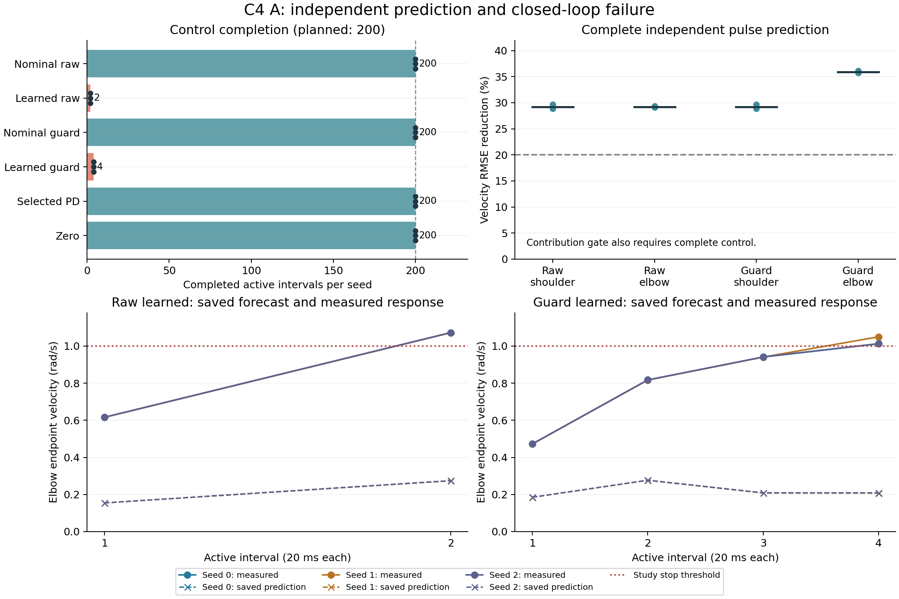

# C4 A：短脉冲预测改善，双关节学习控制停止

从 clean `e7d495f03439ab0380a7b1db7cd81cdf43560644` 按[事前冻结协议](GUARD_PAIR_DEVELOPMENT_PROTOCOL.md)首次执行24条开发试验：**18完整、6研究速度停止、0异常、0依赖blocked**。三个seed的400区间共享校准和100区间独立预测均完整；两种学习模型控制分别只完成2和4个active区间，均因左肘速度达到1 rad/s研究阈值停止。名义模型、选定PD及zero全部完成200区间。因此两种输入basis的身体学习贡献与PD比较门均未通过，不能用停止前RMSE宣称控制改善。

## 完整性与独立预测

| 每seed试验 | 三seed的active完整区间 | 状态 |
|---|---|---|
| 共享calibration | 400 / 400 / 400 | 完整；两个cold diagonal模型分别更新 |
| 独立prediction | 100 / 100 / 100 | 完整；四模型与persistence同轨迹评分 |
| nominal_raw | 200 / 200 / 200 | 完整 |
| learned_raw | 2 / 2 / 2 | 肘速度研究停止 |
| nominal_guard | 200 / 200 / 200 | 完整 |
| learned_guard | 4 / 4 / 4 | 肘速度研究停止 |
| PDselected 64/(0,4) | 200 / 200 / 200 | 完整 |
| zero | 200 / 200 / 200 | 完整 |

独立100区间prediction的原始速度RMSE相对匹配nominal：raw肩改善28.907%–29.711%，肘29.084%–29.356%；guard肩相同，肘35.741%–36.118%。这些完整预测的数值均超过20%阈值，但完整控制也是贡献门的必要条件。首审的`prediction_axes_passed`随整体eligible而为false，不表示上述独立预测数值没有改善。此轨迹是已见开发seed中的新1/9测试，不能称旧low/full门复现或未见泛化。

图仅绘制首审已保存指标与日志中的原有预测，完整性柱不排序停止组的截短误差。原始与公共规则输入分别比较匹配名义模型；规则收益不归到RLS。

## 完整对照与失败原因

| 完整200区间控制 | 三seed联合RMSE原始均值 / rad | 双轴实际绝对努力均值 / N m s | 实际平方努力均值 / N² m² s |
|---|---:|---:|---:|
| nominal_raw | .044504047 | 1.505417 | .719469 |
| nominal_guard | .044417748 | 1.400750 | .663719 |
| PDselected | .010660461 | 2.723021 | 1.219087 |
| zero | .063269013 | 0 | 0 |

nominal_guard相对nominal_raw在seed0/1/2的跟踪变化分别为−.4774%、+1.5627%、−.5296%，没有一致优势。学习组停止前的努力较少仅因为区间少，不能解释为节能或低风险。PD与此前开发的完整结果一致，但本轮没有身体学习优于PD的证据。

已保存的控制决策显示明显低估连续动作响应：seed0 raw首active请求(−.5,+.5) N m，预测肘终点速度.154632 rad/s，实测.615811；下一active仍选同命令，预测.274505、实测1.071841并停止。guard首active请求(−.5,+.375)，预测.184934、实测.472129；第四active预测.208392、实测1.012176并停止。其余seed同样停止。此诊断只提取原预测和原生响应，没有另调用模型或计算反事实动作。

这支持“孤立短脉冲上的预测改善尚未覆盖持续双轴控制”这一局部结论。缺少关节间耦合、输入激励覆盖和模型结构偏差是待区分的原因；不能据此直接断言耦合已经被否定，或把提高停止阈值当作修复。下一项B按同一已付费校准重放cold九参数耦合模型，保持原MPC、200区间任务、权限与停止。其自身贡献和PD门独立判定；由于A diagonal控制不完整，原耦合增量控制门不能靠截短对照通过。C5适应与C6成熟科学采用仍依赖有效的双关节模型，工程准备可继续。

## 实际成本、审计与证据边界

新增**6,318控制调用 / 63,180物理子步 / 4,800 scalar RLS更新**，非完整计划7,500的替代数。prefix2,400、calibration1,200、prediction300、control2,418调用均计入；两个模型各每seed400 vector更新，合计2,400 vector /4,800 scalar。无评估更新、策略/增益/门控更新、教师、外部演示或GPU。

RLS内部旧状态预测2,400 pair/4,800 scalar；独立预测与控制起点诊断合计2,418 pair/4,836 scalar。MPC实际数学预测1,101,492 pair/2,202,984 scalar，失败与未知scalar均0。collector wall85.8996764 s、CPU84.890625 s，wrapper wall88.1491789 s；规划计时合计64.5194417 s。这些数学操作与物理交互分别报告，不为汇总重复fit/predict。正式累计**238,502控制 / 2,385,020子步 / 17,652 scalar更新**，旧失败、PD开发与探针费用仍保留。

全时域ground-force峰553.498534 N、动能峰1.326261 J、最大穿透.003606 m来自共同付费prefix；active control组最大采样力74.772671 N、动能.008263 J。子步力/能量/实际努力与原生endpoint速度的采样含义不同。速度研究停止也不是环境硬停止；本轮不能证明安全或风险下降。

首次独立标准库审计**3,207,643项零失败**，最大差6.590284e−13，wall35.7109214 s/CPU33.859375 s；核验原生信号、原子RLS、每个MPC候选、停止、真实费用、PD来源和clean源码。一次独立描述汇总6,489项字节/结构绑定零失败，wall1.2563518 s，六raw与first audit每份各一次读取，无重审/fit/predict。记录正确与科学门失败同时成立。

全部原件、冻结源码、首审、一次汇总、18条失败控制决策提取及工程首失败见[封口清单](../results/cpu_validation/2026-10-11_guard_pair/manifest.json)。首次59版审计提升、合成schema错误、外层suite计账漏筛和只读纠正均保留；没有正式物理补跑。当前只支持局部双关节开发的正负机制结果，没有技能成熟、行走、动力学适应、未见泛化或真机结论。持续目标保持active，提交后继续B。
