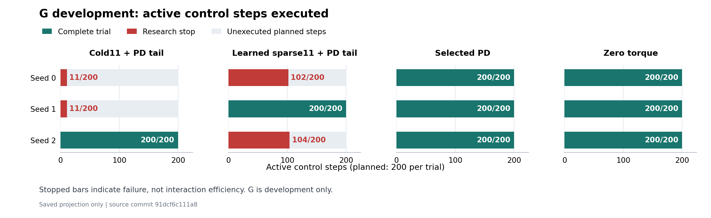

# C4 G：固定反馈尾控制开发结果

按[冻结协议](GUARD_PD_TAIL_CONTROL_DEVELOPMENT_PROTOCOL.md)，2026-10-11从 clean `91dcf6c111a87427c8f3fdd8b959d4792b1bb5a2`首次执行一次。12条轨迹中 **8完整、4肘速度研究停止、0异常、0blocked**。学习组只有seed1完成全部200active，冷模型只有seed2完整。控制假设、PD参考和完整矩阵均未通过；C4科学验收及C5依赖仍未解除。

## 结果与边界

唯一修订是将预测h1..14替换为已选PD64/(0,4)在各候选自身预测状态上的反馈，实际仅执行原81候选中的h0。目标、权限、代价、H15、forecast .15rad/1.5rad/s和真实study stop .12rad/1rad/s保持原样。PD控制能力和旧调优预算是公开先验；身体模型仅恢复D sparse11，新增更新为零。

| 方法 | seed0 active | seed1 active | seed2 active |
|---|---:|---:|---:|
| cold11 | 11，肘速度停止 | 11，肘速度停止 | 200，完整 |
| learned_sparse11 | 102，肘速度停止 | 200，完整 | 104，肘速度停止 |
| PDselected | 200，完整 | 200，完整 | 200，完整 |
| zero | 200，完整 | 200，完整 | 200，完整 |

cold seed0/1的末肘速度分别为−1.00417996、−1.00536656rad/s；学习seed0/2分别为1.07094720、1.06543372rad/s。末行step分别为110、110、201、203，均完整执行10子步，保留在实际费用与风险中。

只列完整轨迹的joint tracking RMSE：cold seed2为.04849428rad，学习seed1为.01042026rad；PD三个seed为.01040145/.01064447/.01093547rad，zero为.06326976/.06319965/.06333764rad。不同seed的单条完整轨迹不构成方法比较，部分RMSE不排名，也不把提前停止计为交互效率优势。

seed1完整并不满足三seed完整优先条件。学习seed1的肩轴误差仍大于同seed PD，不能用joint的微小降低代替逐轴门。G也产生了cold seed0/1的早期失败；这支持保留本候选负结果，不支持普遍采用反馈尾。不能从这次开发推断全身技能、风险下降或新留出优势。

control_hypothesis和pd_reference均evaluated=false/passed=false；matrix_complete=false；c4_scientific_validation仍固定false。D原共同脉冲预测20%门失败保持原结论，G不追认旧门。所有逐seed实际努力、饱和、预测、fallback和风险保存在[一次薄汇总](../results/cpu_validation/2026-10-11_guard_pd_tail_control/summary_once/summary.json)。冷模型fallback为3/3/106，学习三seed均0；无可行轨迹的zero fallback不等于预测安全保证。

## 实际费用

新增 **3,028控制调用 /30,280子步 /0更新**，其中共同零前缀1,200/12,000，active实际1,828/18,280。诊断3,656pair/7,312scalar，规划695,835pair/1,391,670scalar。完整保存的628个规划决定实际支付50,868首步候选与644,967反馈尾向量计算，计账完整，无未知失败规划。尾stage被拒绝之前的计算也计费。

采集wall/CPU为129.374920/124.765625秒，外层wall130.091057秒。首审wall/CPU58.671062/55.390625秒，外层wall59.113013秒；独立重算699,491pair/1,398,982scalar及644,967尾请求，0新物理/更新。原生模型恢复、复制、guard、来源读取、压缩与绘图分别计账，零更新不表示零计算。

正式物理累计 **252,690控制调用 /2,526,900子步**；历史在线22,452+离线7,200=29,652scalar更新计算保持不变。没有用3,600/36,000计划上限替代停止后的实际费用。

## 来源、检查与继续项

[首审](../results/cpu_validation/2026-10-11_guard_pd_tail_control/first_audit.json)1,422,925项零失败只证明来源、隔离、日志、预算和冻结判门的一致性。一次薄汇总35绑定检查零失败，未调用模型或重算科学统计。首次原始数据、源码ZIP、stdout、外层费用与审计均保留于[原件清单](../results/cpu_validation/2026-10-11_guard_pd_tail_control/manifest.json)。

结果原字节归档24payload/6,059,077bytes，24复制检查零失败；49次binary opens/12,318,638bytes，wall/CPU .380769/.046875秒，不含末manifest写盘。绘图只读取已保存完成步数，没有新的改善统计或部分误差排名；一次render及源码/读取费用另存figure/run.json，图已检查布局。归档没有重复物理、预测、首审或汇总。

| 原件 | SHA256 |
|---|---|
| raw manifest | `7eff4abb7cbe9c42a66d59615939a63a491c56fe87b5271d4ff4836d7b220a4c` |
| first audit | `ad98a41ea342808521945fac998a864eff9709d1593fbb3c3c459ce2d48d60bc` |
| saved summary | `72346f34f9b782351a68caeb255a559a6320b9d67f2527a7a969719933d50822` |

[准备原件](../results/cpu_validation/2026-10-11_guard_pd_tail_preparation/manifest.json)85payload/1,088,236bytes；79首次复制项复用。首清单schema失败原件和小范围恢复均保存，不改称首零失败。普通Git add漏掉嵌套external快照及随后长路径失败也保留[交付说明](../results/cpu_validation/2026-10-11_guard_pd_tail_preparation/GIT_DELIVERY_NOTE.md)；修复忽略例外并补充提交，首次物理从完整、干净、已推送的91dcf6c执行。没有因此重复任何数学或物理。

接着H固定保存诊断：逐stage检查选中forecast是否越过真实研究停止界限，并描述固定末20窗口的一步预测与实际端点差异。它不重构候选、运行模型或改变旧门；若预测本身允许超过study stop，才据证据另冻单项规划约束修订；若预测安全而实际停止，则保留身体模型失配问题。不能先假设收紧forecast会成功，也不直接增加模型特征或探索预算。完成检查、提交、推送后继续[持续目标](CONTINUOUS_EXECUTION_PLAN.md)，不在本负结果或局部轨迹成功后结束。
