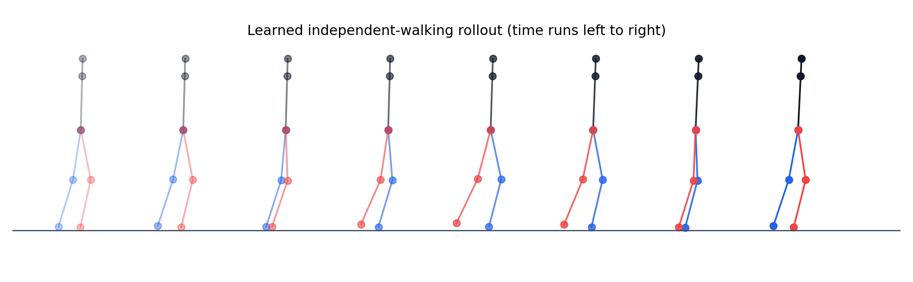
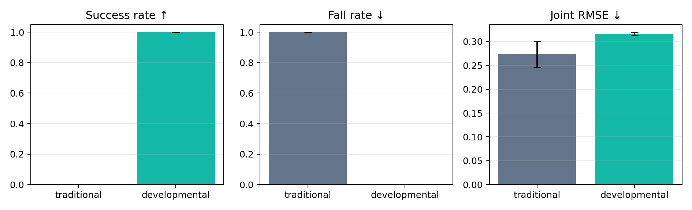

# 基于人体运动先验与发育课程的二维火柴人行走控制：理想状态下的概念验证

> 作者：待填写  
> 单位：待填写  
> 稿件类型：方法概念验证 / Preliminary Study  
> 版本：2026-08-24

## 摘要

当前人形机器人运动控制通常依赖大规模并行仿真与从零强化学习，而人类运动能力则通过身体探索、平衡、重心转移和辅助行走等阶段逐步形成。本文研究一个受限但可证伪的问题：在二维理想动力学代理中，融合人体运动先验、Body Schema 辅助学习和发育课程，能否比同预算的直接 PPO 更安全地获得无支撑行走策略。我们构建了具有四个腿部关节、躯干倾角、理想化足底接触和步态时钟的二维火柴人环境，并提出 DHP-PPO（Developmental Human-Prior PPO）。该方法依次训练身体探索、平衡、重心转移、辅助行走和独立行走五个阶段，以前向模型预测下一时刻本体状态，并以交替步态与前庭平衡反射构成可审计的人体运动先验。对照组使用相同 PPO 网络和 76,800 次环境交互，但从随机初始化直接学习独立行走。使用未参与调参的 5 个随机种子，每个策略在关闭外部支撑后测试 30 回合。DHP-PPO 在 5/5 个种子和 150/150 个测试回合中成功，测试跌倒率为 0；直接 PPO 在 0/5 个种子和 0/150 个回合中成功，测试跌倒率为 1。训练期严重跌倒由 $1402.8\pm47.5$ 次降至 $63.0\pm7.0$ 次，降幅为 95.51%。发育组额外使用了 8,192 个合成人体先验监督样本，因此结果证明的是组合方案在理想环境中的可行性，而不是同等总数据条件下单一课程因素的因果优势。本文还讨论了简化动力学、固定步态时钟、基线范围、样本非独立性和缺少消融等限制，并给出进入 MuJoCo/Isaac 与真实机器人验证所需的下一步实验。

**关键词：** 发育机器人；人形机器人；运动学习；强化学习；人体运动先验；Body Schema；安全学习

## 1 引言

基于运动模仿和强化学习的方法已经能够在仿真中获得复杂的全身运动 [1–3]，但常见流程需要大量环境交互、并行实例和失败复位。当学习迁移到真实机器人时，跌倒、电机冲击、人工复位和硬件磨损不再是近乎免费的训练信号。相比之下，人类运动发育呈现从低风险、多接触和外部支撑向高风险、少接触和自主控制逐步过渡的特征 [4]。

发育式学习并不意味着拒绝强化学习，而是改变学习问题的组织方式：复杂技能不再每次从随机策略开始，而是建立在身体模型、低维运动基元和先前技能之上。已有研究分别表明，自模型能够支持机器人适应 [5,6]，低维运动基元能够组织复杂动作 [7]，以及课程与模仿信息能够改善策略学习 [2,8]。然而，在统一控制预算内，身体先验、技能阶段和安全失败指标如何共同作用，仍需要由最小实验开始验证。

本文不直接声称解决真实人形机器人行走，而是先回答：

> 在透明、低成本的理想二维代理中，“人体先验 + Body Schema + 发育课程”这一组合方案是否至少能够学会无支撑行走，并显著减少训练期严重失败？

本文贡献如下：

1. 提供一个可复现的二维火柴人发育式运动学习基准，同时记录成功率、跌倒、总交互、距离和动作跟踪误差；
2. 实现 DHP-PPO，将条件化发育课程、下一状态预测和可审计的人体步态/平衡先验整合到同一策略中；
3. 在未见随机种子上与同环境交互预算的直接 PPO 对比，并公开报告额外人体先验样本与不利指标；
4. 明确当前结果只能支持理想环境中的组合可行性，不能支持 Sim2Real、真机安全性或各组件独立贡献的结论。

## 2 问题定义

### 2.1 火柴人状态与动作

火柴人由躯干和左右两条二连杆腿组成。四维动作

$$
a_t=[a_{lh},a_{lk},a_{rh},a_{rk}]\in[-1,1]^4
$$

分别控制左右髋、膝的目标位置。18 维观测包含：4 个关节角、4 个缩放关节速度、躯干倾角与角速度、前向速度、步态相位的正余弦、左右接触标志，以及课程任务条件（步态幅度、目标速度、外部支撑强度）。将任务条件显式放入观测可避免不同发育阶段之间的策略覆盖。

关节采用二阶伺服代理：

$$
\ddot q_t=28(q_t^{target}-q_t)-5.5\dot q_t.
$$

躯干为带主动髋部反馈和外部支撑的简化倒立摆：

$$
\ddot\theta_t=(5.8-10s)\theta_t-(2.5+3s)\dot\theta_t
-8\bar q_{hip}^{target}+\epsilon_t,
$$

其中 $s\in[0,1]$ 为外部支撑强度，$\epsilon_t$ 为阶段相关小扰动。当前向推进由步态跟踪质量与直立质量共同决定。该模型故意保持透明和低计算成本，不等价于刚体接触动力学。

### 2.2 参考人体步态

人体先验使用一个低维交替周期基元：

$$
q_{lh}^{ref}=0.48\sin\phi,\qquad
q_{rh}^{ref}=0.48\sin(\phi+\pi),
$$

$$
q_{lk}^{ref}=0.10+0.50\max(\sin\phi,0),
$$

$$
q_{rk}^{ref}=0.10+0.50\max(\sin(\phi+\pi),0).
$$

再加入类似前庭反馈的共模髋部修正：

$$
c_t=0.70\theta_t+0.12\dot\theta_t.
$$

该先验不是人体运动捕捉数据，而是受人体左右交替步态与平衡反射启发的解析近似。将其称为“人体运动先验”而不是“真实人体步态模型”更准确。

### 2.3 终止与成功

时间步长为 0.04 s，每回合最多 300 步，即 12 s。当 $|\theta|>0.62$ rad 或双膝平均过度屈曲时记为严重跌倒并终止。无支撑测试回合同时满足以下条件才记为成功：

$$
\text{no fall}\;\land\;\bar v_x\ge0.70\;\land\;\mathrm{RMSE}_{joint}\le0.38.
$$

## 3 方法

### 3.1 传统直接 PPO 基线

基线使用 PPO [1]，策略和价值网络均为两层 64 单元 Tanh MLP，二者不共享编码器。策略从随机初始化开始，全部 40 次更新均在无外部支撑、目标速度 1.0 的独立行走任务中完成。除发育组件外，优化器、网络宽度、rollout 长度、环境数和最终奖励定义与 DHP-PPO 一致。

本文中的“传统组”只指这一直接 PPO 基线，不能外推为所有传统机器人算法，更不能代表经充分调优的 PBHC、DeepMimic、SAC、模型预测控制或大规模并行训练系统。

### 3.2 条件化发育课程

DHP-PPO 依次经历五个等长阶段，每阶段使用 15,360 次环境交互：

| 阶段 | 步态幅度 | 目标速度 | 外部支撑 | 主要能力 |
|---|---:|---:|---:|---|
| Body Babbling | 0.35 | 0.00 | 1.00 | 安全关节响应 |
| Balance | 0.00 | 0.00 | 0.55 | 直立与姿态稳定 |
| Weight Transfer | 0.65 | 0.40 | 0.35 | 左右协调和重心转移 |
| Supported Walk | 1.00 | 0.75 | 0.18 | 连续辅助步态 |
| Independent Walk | 1.00 | 1.00 | 0.00 | 无支撑行走 |

课程使风险从低到高、支撑从强到弱，且所有阶段复用同一条件策略，不重置参数。

### 3.3 Body Schema 辅助目标

策略编码器 $z_t=e_\psi(o_t)$ 同时输入前向模型：

$$
\hat p_{t+1}=f_\omega(z_t,a_t),
$$

其中 $p_{t+1}$ 为 11 维下一时刻本体状态。辅助损失为：

$$
\mathcal L_{body}=\|\hat p_{t+1}-p_{t+1}\|_2^2.
$$

总损失包含 PPO 策略损失、价值损失、熵正则、Body Schema 损失和人体先验正则：

$$
\mathcal L=\mathcal L_{PPO}+0.5\mathcal L_V-0.005\mathcal H
+0.08\mathcal L_{body}+0.50\mathcal L_{prior}.
$$

策略编码器与价值编码器分离。这一设计来自开发阶段发现的灾难性覆盖：共享编码器时，较大的价值回归梯度会破坏已经学到的平衡反射。

### 3.4 人体先验初始化

在环境训练前，发育组使用 8,192 个合成状态—先验动作样本初始化策略编码器和动作头，共做 120 次小批量更新。先验样本不计入环境交互，但在结果中单独报告。训练过程中继续使用 $\mathcal L_{prior}$ 抑制遗忘。直接 PPO 不使用这些样本。

因此，本实验公平控制的是“环境交互预算”，而不是“所有信息与监督样本预算”。这一区别是解释结果的必要前提。

## 4 实验设计

### 4.1 主要假设

- H1：在固定环境交互预算下，DHP-PPO 能在理想二维环境中获得无支撑行走，而直接 PPO 不能稳定获得；
- H2：DHP-PPO 的训练期严重跌倒次数低于直接 PPO；
- H3：即使成功率提高，动作跟踪 RMSE 也不保证同时改善，因此必须联合报告安全、任务和动作指标。

### 4.2 训练配置

| 参数 | 数值 |
|---|---:|
| 并行环境数 | 24 |
| 每次 rollout 步数 | 80 |
| PPO 更新次数 | 40 |
| 每方法每种子环境交互 | 76,800 |
| PPO epoch / update | 4 |
| minibatch | 768 |
| 学习率 | $3\times10^{-4}$ |
| 折扣因子 $\gamma$ | 0.99 |
| GAE $\lambda$ | 0.95 |
| clip | 0.2 |
| 未见训练种子 | 10, 11, 12, 13, 14 |
| 每策略测试回合 | 30 |

种子 0–4 用于开发与超参数检查；主结果只使用未参与调参的种子 10–14。最终测试统一设为 `independent_walk` 且外部支撑为 0，使用确定性策略均值。

### 4.3 评价与统计

主要指标为成功率、测试跌倒率、训练期累计跌倒、环境交互数和人体先验样本数；次要指标为平均速度、12 s 内平均距离和关节跟踪 RMSE。连续指标按种子配对，报告均值、标准差、配对差的 95% t 区间、配对 t 检验和 Wilcoxon 符号秩检验。由于 $n=5$ 很小，显著性结果仅作描述，非参数检验和效应量优先用于判断稳健性。30 个回合共享同一训练策略，不能视为 30 个独立训练重复。

## 5 结果

### 5.1 未见种子主结果

| 指标 | 直接 PPO | DHP-PPO | 方向 |
|---|---:|---:|---:|
| 成功率 | $0.000\pm0.000$ | $1.000\pm0.000$ | DHP-PPO 更高 |
| 测试跌倒率 | $1.000\pm0.000$ | $0.000\pm0.000$ | DHP-PPO 更低 |
| 训练期跌倒 | $1402.8\pm47.5$ | $63.0\pm7.0$ | 减少 95.51% |
| 平均速度 | $0.668\pm0.017$ | $0.783\pm0.022$ | 增加 0.115 |
| 平均距离 | $1.899\pm0.318$ | $9.400\pm0.266$ | 4.95 倍 |
| 关节 RMSE | $0.273\pm0.027$ | $0.316\pm0.003$ | DHP-PPO 更差 |
| 环境交互 / 种子 | 76,800 | 76,800 | 相同 |
| 先验监督样本 / 种子 | 0 | 8,192 | DHP-PPO 更多 |

DHP-PPO 在 5/5 个未见训练种子中获得成功，共 150/150 个测试回合无跌倒；直接 PPO 在 0/5 个种子中成功，150 个测试回合均在回合结束前跌倒。训练跌倒的种子配对差为 $-1339.8$ 次，95% t 区间为 $[-1400.7,-1278.9]$。配对 t 检验为 $p=4.30\times10^{-7}$，但 Wilcoxon 检验为 $p=0.0625$；后者反映了只有 5 对样本时的有限统计把握。



图 1 展示一个无支撑测试回合中的单步周期。左右腿产生交替摆动，躯干倾角保持在终止阈值内。


图 2 显示训练期累计跌倒。直接 PPO 从训练初期持续跌倒；DHP-PPO 在有支撑的早期阶段几乎没有严重失败，主要失败集中在最后解除支撑的阶段。



图 3 比较最终成功、测试跌倒和关节 RMSE。关节 RMSE 的反向结果说明仅优化动作相似性不足以保证长期稳定。

### 5.2 对不利结果的解释

DHP-PPO 的关节 RMSE 比直接 PPO 高 0.043，配对差 95% 区间为 $[0.008,0.078]$。这并不表示直接 PPO 整体控制更好。直接 PPO 的指标只累积到早期跌倒时刻，且策略可能在短时内贴近参考轨迹，却没有学到足够的共模髋部平衡反馈；DHP-PPO 则需要完成完整 12 s 回合。该结果揭示了两个问题：一是终止导致的生存者/暴露时间差异会影响跟踪指标；二是动作相似性与闭环稳定性是不同目标。后续应报告固定时间窗 RMSE、跌倒前 RMSE 和完整存活回合 RMSE，避免直接混合。

## 6 讨论

### 6.1 当前结果支持什么

结果支持 H1 和 H2：在该二维理想代理和当前训练预算下，完整组合方法可以获得可重复的无支撑行走，并大幅减少严重训练失败。它证明这条研究路线值得进入更真实的刚体仿真，而非仅停留在概念描述。

结果也支持 H3：成功和安全指标改善并不自动带来更低关节 RMSE。论文与项目评价体系应以“是否完成、是否跌倒、用了多少真实交互和多少外部信息”为主，动作跟踪误差为辅。

### 6.2 当前结果不支持什么

本实验不能证明：

- 该方法已经适用于 G1 或任何真实人形机器人；
- 发育课程单独优于直接 PPO；
- Body Schema、人体先验或课程中任一组件是性能提升的唯一原因；
- DHP-PPO 在相同总数据和相同先验条件下优于所有传统算法；
- 固定解析步态先验等同于从真实人体数据提取的 muscle synergy；
- 当前方法已经实现低样本 Sim2Real。

### 6.3 主要限制

1. **动力学过度简化。** 前向速度由步态跟踪质量代理，不是从摩擦、冲量和刚体接触自然产生；足接触由相位近似给出。
2. **固定步态时钟。** 控制器不需要自主发现步频，也没有处理相位漂移、停走切换和非周期动作。
3. **额外先验信息。** 发育组使用 8,192 个监督样本，而基线没有；结果是系统级方案比较，不是纯样本效率比较。
4. **缺少组件消融。** 目前没有独立比较仅课程、仅人体先验、仅 Body Schema、共享/分离编码器和去除任务条件。
5. **基线范围窄。** 只比较了中等预算直接 PPO，未覆盖更长训练、奖励重调、DeepMimic/PBHC、SAC 或模型式控制。
6. **统计规模有限。** 只有 5 个独立训练种子，成功率饱和，Wilcoxon 检验未低于 0.05。
7. **无真机风险模型。** 未模拟传感噪声、延迟、关节间隙、力矩饱和、温升、碰撞冲击和人工复位。

### 6.4 下一阶段实验

下一阶段应按以下顺序推进：

1. 在当前环境完成 $2^3$ 因子消融：课程、Body Schema、人体先验分别开/关，并增加 20 个未见种子；
2. 增加先验数据预算匹配基线，例如给直接 PPO 同量行为克隆数据但不使用课程；
3. 将环境迁移到 MuJoCo 平面双足模型，取消直接速度代理和相位接触，加入真实足—地碰撞；
4. 与 PPO-from-scratch、DeepMimic/PBHC 风格模仿、SAC 和模型预测控制比较达到固定成功率所需交互；
5. 加入传感噪声、控制延迟、质量/摩擦随机化、推扰和执行器饱和，建立 Pre-Failure 预测器；
6. 最后在吊架保护的真机上只做低风险 Body Babbling 与站立实验，预注册跌倒、人工复位、能耗和硬件应力口径。

## 7 结论

本文将“类人发育式人形机器人运动学习”缩小为一个可运行的二维理想状态概念验证。融合人体步态/平衡先验、下一状态预测和渐进支撑课程的 DHP-PPO，在未见随机种子上稳定获得了无支撑火柴人行走；在相同环境交互预算下，其训练期严重跌倒比直接 PPO 减少 95.51%。这一结果说明“先形成可迁移的身体与运动先验，再学习复杂步态”在最小代理中是可行的。由于环境简化、先验数据不对等和缺少消融，当前证据的正确表述是“路线通过了第一阶段可行性检查”，而不是“已经证明优于传统人形机器人训练算法”。真正决定项目成立与否的下一关，是在真实接触动力学、匹配信息预算和组件消融条件下，能否继续保持更少交互与更少严重失败。

## 参考文献

[1] Schulman J, Wolski F, Dhariwal P, et al. Proximal Policy Optimization Algorithms. arXiv:1707.06347, 2017.

[2] Peng X B, Abbeel P, Levine S, van de Panne M. DeepMimic: Example-Guided Deep Reinforcement Learning of Physics-Based Character Skills. *ACM Transactions on Graphics*, 37(4), 2018.

[3] Hwangbo J, Lee J, Dosovitskiy A, et al. Learning agile and dynamic motor skills for legged robots. *Science Robotics*, 4(26): eaau5872, 2019.

[4] Thelen E, Smith L B. *A Dynamic Systems Approach to the Development of Cognition and Action*. MIT Press, 1994.

[5] Bongard J, Zykov V, Lipson H. Resilient machines through continuous self-modeling. *Science*, 314(5802): 1118–1121, 2006.

[6] Cully A, Clune J, Tarapore D, Mouret J B. Robots that can adapt like animals. *Nature*, 521: 503–507, 2015.

[7] Ijspeert A J, Nakanishi J, Hoffmann H, et al. Dynamical Movement Primitives: Learning Attractor Models for Motor Behaviors. *Neural Computation*, 25(2): 328–373, 2013.

[8] Bengio Y, Louradour J, Collobert R, Weston J. Curriculum Learning. *Proceedings of ICML*, 2009.

[9] Oudeyer P Y, Kaplan F, Hafner V V. Intrinsic Motivation Systems for Autonomous Mental Development. *IEEE Transactions on Evolutionary Computation*, 11(2): 265–286, 2007.

[10] Ha D, Schmidhuber J. World Models. arXiv:1803.10122, 2018.

## 附录 A：复现

在项目根目录运行：

```powershell
$env:PYTHONPATH = "src"
python -m pytest -q
python -m robot_rl.experiment --seeds 10 11 12 13 14 --updates 40 --num-envs 24 --rollout-steps 80 --eval-episodes 30 --output results/validation
```

逐种子结果位于 `results/validation/metrics_by_seed.csv`，汇总位于 `summary.csv`，统计量位于 `statistics.json`，运行元数据保存在同一目录。模型检查点可由上述命令在本地重新生成，但因体积与版本管理策略不纳入 Git。

### G1 工程验证状态（不属于本文性能结果）

截至 2026-08-26，后续 G1 路线已固定 PBHC `ffac5cde`、Isaac Gym Preview 4 和 PBHC 提供的 Unitree G1 资产，并通过 23 个 action/关节、24 个折叠刚体的静态映射验证。PBHC 原始动作模仿入口和不加载动作文件的纯发育入口均完成了 GPU smoke test。后者已接通成熟动作约束、52 维 Body Schema 辅助头，以及与训练预算分开计账的 held-out competence evaluator。评估器已保证每个环境每个 episode bank 只投一次票，并使用 50/200/1000-step 阶段 horizon 作为内部能力课程。

早期单 seed pilot 暴露并修复了 episode 重复计数、零系数辅助 Adam 更新、self-collision 被误标为地面跌倒、未归一化 torque-limit 项主导回报、晋级后探索噪声失控，以及短 horizon 正常练习被过早退级等问题。随后 Adaptive 诊断轨在固定小学习率下连续通过 200-step gate 并自动进入 1,000-step horizon；截至当前，单个 8,192-episode held-out 窗口的 20-second survival 最好为 0.9517，upright 约 0.999，失败轨迹主要集中在随机初态后的前约 91 control steps。

该数字仍不是“学会完美站立”：内部 0.92 gate 只表示可以进入更长练习。最终标称条件预注册为独立未见 seed 的 8,192 个 1,000-step episodes 中 0 次跌倒，并硬检全程/终点 base height、upright 和双足支撑；扰动与动力学随机化另表报告。当前尚有 396/8,192 失败，且 checkpoint 选择使用了课程 held-out 窗口，不能作为独立测试结论。Direct PPO、Fixed maturation、能力门控 Adaptive maturation 的完整预算对照、强基线、接触估计器、多种子实验和扰动评估均尚未完成，因此摘要和结论仍不提出 G1 样本效率、鲁棒性或安全优势。持续工程记录见 `docs/EXPERIMENT_LOG.md`。

## 附录 B：论文视频材料

- **Supplementary Video S1：** `results/validation/media/developmental_walk.mp4`，展示未见种子模型在关闭外部支撑后的完整 12 s 行走回合；
- **Supplementary Video S2：** `results/validation/media/ppo_vs_developmental.mp4`，同步比较相同环境交互预算下直接 PPO 与 DHP-PPO；
- `developmental_walk.gif` 用于 Markdown、网页或答辩幻灯片快速预览。

建议论文图注：**“Video S1. Independent walking learned by DHP-PPO in the idealized planar stickman environment. The policy is evaluated deterministically on a held-out seed with external support disabled.”**
